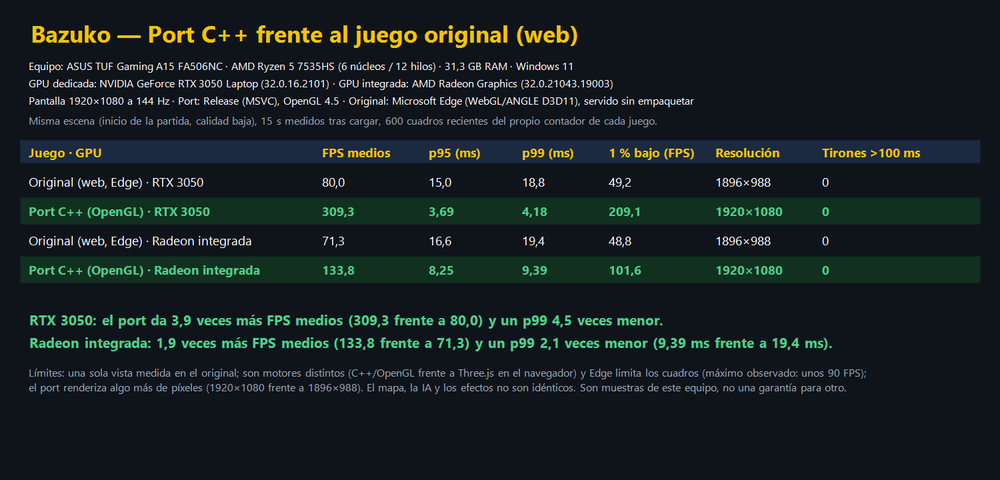
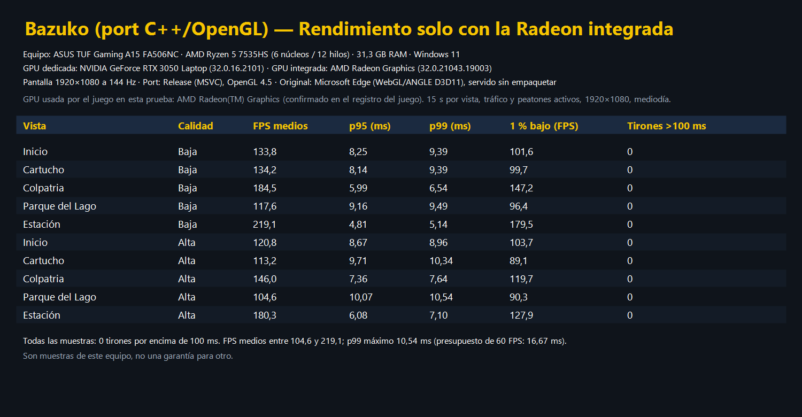

# Bazuko C++ (OpenGL 4.5 Core DSA)

Puerto nativo en C++20 del juego de supervivencia urbana 3D **Bazuko**, ambientado en el centro de Bogotá.

## Arquitectura y Decisiones Técnicas

1. **OpenGL 4.5 Core Profile con Direct State Access (DSA)**:
   - Evita el paradigma clásico de *bind-to-edit* propenso a errores de estado global.
   - Creación y configuración directa de búferes (`glCreateBuffers`, `glNamedBufferData`, `glNamedBufferSubData`).
   - Vertex Arrays desacoplados (`glCreateVertexArrays`, `glVertexArrayVertexBuffer`, `glVertexArrayAttribFormat`), cuya estructura mapea casi 1:1 a los formatos de entrada de Vulkan (`VkVertexInputAttributeDescription`).
   - Uniform Buffer Objects (UBOs) para Cámara, Luces y paletas de hasta 128 huesos (`CameraBlock`, `LightBlock`, `SkinBlock`).
2. **Compatibilidad con Vulkan a futuro**:
   - Capa de abstracción limpia en `src/renderer/`: `Buffer`, `VertexArray`, `Shader`, `Mesh`, `Camera`, `Renderer`.
   - La lógica de juego y el mundo en `src/world/` no realizan llamadas directas a la API gráfica.
3. **Bibliotecas clave**:
   - **Ventana & Contexto**: GLFW 3.4
   - **Loader OpenGL**: GLAD2 (OpenGL 4.5 Core)
   - **Matemáticas**: GLM (vectores, matrices, proyecciones)
   - **Interfaz Gráfica**: Dear ImGui (señalización informativa azul con acentos amarillos)
   - **Formatos y Modelos**: cgltf y Assimp (mallas glTF, FBX, OBJ, STL, Collada, PLY y otros), stb_image, miniaudio, libopusfile, nlohmann/json

## Estructura del Proyecto

```
cpp/
├── CMakeLists.txt
├── assets/
│   └── shaders/
│       ├── default.vert       # GLSL 450 Core con UBOs de cámara y modelo
│       └── default.frag       # Iluminación difusa, ambiente y niebla atmosférica
├── src/
│   ├── main.cpp               # Bucle principal de juego
│   ├── core/
│   │   ├── Window.hpp/.cpp    # Manejo de ventana GLFW y contexto OpenGL 4.5 Core
│   │   ├── Input.hpp/.cpp     # Entrada de teclado, mouse, deltas y pointer lock
│   │   ├── Clock.hpp          # Delta time y tiempo transcurrido de alta precisión
│   │   └── Log.hpp            # Logging estructurado por niveles
│   ├── renderer/
│   │   ├── GL.hpp             # Loader GLAD y callbacks de depuración OpenGL
│   │   ├── Buffer.hpp/.cpp    # VertexBuffer, IndexBuffer, UniformBuffer (DSA)
│   │   ├── VertexArray.hpp/.cpp # VertexArray (DSA)
│   │   ├── Shader.hpp/.cpp    # Compilador y vinculador GLSL 450
│   │   ├── Mesh.hpp/.cpp      # Estructura de vértices y generadores de primitivas
│   │   ├── Camera.hpp/.cpp    # Cámara en tercera persona e isométrica con suavizado
│   │   └── Renderer.hpp/.cpp  # Pipeline de renderizado por pases y sombreado
│   ├── ui/
│   │   └── UIManager.hpp/.cpp # Integración Dear ImGui con tema oscuro bogotano
│   └── world/
│       └── CityLayout.hpp/.cpp# Grilla urbana de Bogotá (carreras, calles, andenes, edificios)
└── third_party/               # GLAD, stb_image, cgltf, miniaudio, nlohmann/json
```

## Compilación y Ejecución

Un solo `CMakeLists.txt` para Windows y Linux. GLFW, GLM, Dear ImGui, libwebp, libogg, libopus y libopusfile se descargan y compilan solos
(FetchContent) si no están instalados; no hace falta `WEBP_ROOT` ni instalar nada más que el compilador.
El proyecto debe quedar dentro del repositorio (`bazuko/cpp`) para que encuentre `../public` (modelos y audio).

### Linux / WSL2 (Ubuntu)

```bash
sudo apt install build-essential cmake ninja-build pkg-config libx11-dev libxrandr-dev libxinerama-dev \
                 libxcursor-dev libxi-dev libgl1-mesa-dev
cd cpp
cmake -S . -B build -G Ninja
cmake --build build -j
./build/bazuko
```

### Windows (Visual Studio 2022 con "Desarrollo para el escritorio con C++")

```powershell
cd cpp
cmake -S . -B build
cmake --build build --config Release --parallel
.\build\Release\bazuko.exe
```

En Windows, el ejecutable se inicia como aplicación gráfica (sin ventana de consola). La pantalla de carga
actualiza el progreso al completar la carga de los modelos de peatones y del personaje.

### Datos compartidos con el juego web

Los objetos (precios, pesos, efectos, qué compra la recicladora), la tienda La Esquinita, las tablas de botín y los talentos
se leen de `assets/data/game-data.json`. Ese archivo no se edita a mano: lo genera `node tools/export-game-data.mjs`
a partir de `src/data/items.js` y `src/data/talents.js`, así el port y el juego web usan los mismos números.
El orden de los objetos es fijo porque las partidas guardadas referencian su índice; los siete objetos que solo existen
en el port (tela, alambre, plástico, mochila, arma casera, curita y cartón de rifa) se definen en el propio exportador.
`ctest` ejecuta `bazuko_gamedata`, que comprueba el orden, la tienda y los efectos de los talentos.

### Basura y clasificación

Las bolsas y canecas dan botín por tiradas como en el original (`game/Harvest`): con `E` o con un toque de `Q` salen 2 objetos
comunes (4 con adrenalina) y 5 % de uno raro; manteniendo `Q` 1,5 s se clasifica: 4 objetos (6) y 12 % de raro, con más riesgo
de enfermar. Lo que no cabe en el costal se queda en la bolsa. Los materiales de un cambuche completo (cartón, tablas, latas,
lona, colchón y vela) viajan en las bolsas y vuelven a aparecer cuando se recogen.

### Aparición segura del jugador

Regla estricta: el jugador nunca aparece ni se carga dentro de un edificio, un modelo o un recinto sin salida. Al iniciar,
cargar una partida, empezar una nueva, recuperarse de la muerte o terminar una caída, la posición pasa por `world/SafeSpawn`:
si está bloqueada, o desde ella no se puede llegar a una zona abierta, se mueve al lugar libre con salida más cercano (hasta
80 m; si no hay, al punto de inicio) y, al cargar una partida, se avisa en pantalla. `bazuko_safespawn` prueba la lógica y
`bazuko_spawn_city_test.exe` la comprueba sobre la ciudad real (todas las baldosas no caminables y cientos de puntos al azar).

### Mapa y hitos del original
El mapa es el del juego web: 198 x 120 baldosas de 2 m (396 x 240 m) en el mismo marco de coordenadas del original (`ORIGIN_X` 1, `ORIGIN_Z` 75), con 37 filas al norte para la estación Portal del Centro y el Parque del Lago al sur desde Z 222. `tools/export-city-map.py` replica la generación del original (calles, parques, ruinas, jardines, reservas) y escribe `assets/data/city-map.json`, que carga `CityLayout`; así el cambuche (112,98; 94,64), los vendedores, la recicladora, el dealer y las rutas de tráfico usan las posiciones exactas del original. Las calles son las de la Caracas con su troncal, las carreras 15, 10, 8 y 6 y las calles 10, 9, 8 y 7, con postes de nomenclatura en las esquinas y en los parques. El viaducto elevado (`src/world/Viaduct.hpp`) es un único tablero de 14 m: una rampa norte sube a 7,82 m desde Z 15,43, el eje se desvía 44 m al este para rodear Colpatria (curva suave entre Z 80 y 260), cruza el lago y baja al borde sur (Z 318). Es una capa de movimiento aparte (`playerOnDeck`): el jugador sube solo por el extremo bajo de la rampa, camina entre las barandas, pasa por debajo cuando está en la calle y solo choca con el bus elevado; los carros y los buses no se ven entre sí. Dos buses recorren los carriles de cada sentido (X 78,5 y 71,5), siguen la curva y paran cuatro segundos en la estación (isla de 40 m a 0,92 m con rampas peatonales, centro en X 75, Z -30). Además de la gasolinera, la tienda D69, la pasarela, Colpatria con su anexo y el edificio de ladrillo, el radar marca los hitos. Las partidas guardadas con la distribución anterior (sin `mapVersion`) conservan su progreso, pero el jugador reaparece junto al cambuche. El guardado conserva si el jugador estaba sobre el tablero.

Estacion Portal del Centro (`src/world/Station.hpp`): isla accesible de 4 m entre los dos carriles del troncal en el extremo norte (Z -108 a -72), con rampas peatonales en cada extremo (la cota del suelo sube a 0,92 m), cubierta, columnas, galerias de vidrio y rotulos; el jugador la sube por sus rampas. Hay dos buses articulados (`BusState`): el del norte sale del extremo sur del puente, sube por el viaducto y para 4 s en la estacion por el carril este; el del sur sale de la estacion por el carril oeste, cruza el viaducto y el puente, y ambos relevan en los extremos. Cada uno tiene su voz de motor y se inclina con la rampa. La torre Colpatria (112 m, con costillas, franjas de colores que brillan de noche, anexo gris y rotulos) queda en la orilla este del lago, y junto al extremo sur del viaducto hay un edificio de ladrillo de cinco pisos. A diferencia del original, el viaducto es recto: Colpatria no esta sobre el eje de la avenida del port, asi que no hace falta el rodeo curvo.

Cielo nocturno (`src/world/StarField.hpp`): 700 estrellas blancas, azuladas y calidas sobre una semiesfera que sigue a la camara, sin iluminacion ni niebla (modo cielo del renderer). Aparecen al oscurecer (con las farolas) y se apagan con la lluvia y la neblina. Los postes de nomenclatura vial (Calle 10, Carrera 15, Av. Caracas...) marcan cada cruce y los parques.

Verificacion visual sin pulsar teclas: `BAZUKO_SHOT=captura.png` guarda una captura a los 6 s y cierra el juego (`BAZUKO_SHOT_DELAY`, `BAZUKO_YAW`, `BAZUKO_PITCH` y `BAZUKO_DIST` ajustan el retardo y la camara; la posicion sale del guardado).

### Radio transistor

`R` o el botón de radio abren el sintonizador: encender/apagar, batería (100 % dura unos 40 min; las pilas AA suman 50 %),
volumen propio y las cuatro emisoras de `assets/radio_stations.json`. Suena una síntesis lo-fi como la del juego web
(`audio/RadioSynth`: cumbia, boletín con campana, corneta de estadio y rock), con ruido de estática y filtro de altavoz;
escucharla sube el ánimo. Las emisoras con otro `id` solo dan estática. No hay reproducción de streams en línea.

### Windows desde WSL (compilación cruzada con MinGW-w64)

```bash
sudo apt install mingw-w64 cmake ninja-build
cmake -S . -B build-win -G Ninja -DCMAKE_TOOLCHAIN_FILE=toolchain-mingw64.cmake -DCMAKE_BUILD_TYPE=Release
cmake --build build-win
# build-win/bazuko.exe + build-win/assets/ (copia ambos junto a la carpeta public/)
```

### Dónde busca los recursos

El juego localiza `assets/` (shaders, fuente de los rótulos) y `public/` (modelos y audio) junto al ejecutable,
en las carpetas superiores y en el directorio actual, así que arranca desde `build/`, `build/Release/` o con doble clic.
Para indicar otra carpeta: `bazuko --public <ruta a public/>` o la variable `BAZUKO_PUBLIC`.
Con `-DBAZUKO_COPY_PUBLIC=ON` se copia `public/` junto al ejecutable (~50 MB) para llevarlo a otro equipo.

### Ratón en WSL2

WSLg no entrega bien el modo de cursor oculto/bloqueado de GLFW, por eso la cámara con el ratón puede fallar allí.
En WSLg se puede girar la cámara arrastrando con un botón del ratón o con las flechas. En Windows nativo
(compilado con MSVC o MinGW) el ratón funciona con normalidad.

### Controles iniciales:

- `W`, `A`, `S`, `D`: Moverse por las calles y andenes de la ciudad.
- `Shift`: Correr.
- `Q`: Recoger un objeto cercano; junto a un peatón, intentar un robo directo; junto al dealer, abrir su catálogo.
- `E`: Interacción contextual; hablar, acercarse al perro, comprar, vender reciclables en la recicladora, vender sustancias al dealer de noche, robar espejos o usar un consumible.
- `Z`: Hacer popó; consume hambre e higiene y deja un mojón en el suelo.
- `X`: Lanzar un mojón del costal; si no tienes uno, hace popó.
- `F`: Entregar reciclables para la misión, únicamente en la recicladora.
- `C`: Abrir/cerrar el crafteo; fabrica objetos si tienes ingredientes.
- `I`: Abrir/cerrar el inventario; usar, soltar u ordenar objetos. El mundo queda en pausa mientras está abierto.
- `T`: Abrir/cerrar el árbol de talentos; los puntos se obtienen al subir de nivel.
- `O`: Abrir/cerrar la ficha de El Chato; editar su nombre y pelaje, y acariciarlo.
- `B` / `L`: Pedir limosna.
- `R`: Abrir o cerrar la radio.
- `N`: Mostrar u ocultar el radar.
- `P`: Abrir el creador y personalizador del personaje.
- `Tab` o `I`: Abrir el inventario (cuadrícula con detalle; `1`–`5` asignan la barra rápida, `Enter` usa, `X` tira). Con el cursor libre, un clic lo captura; también se puede girar la cámara arrastrando.
- `Flechas`: Girar la cámara; `Rueda del mouse`: acercar o alejar.
- `F11`: Alternar pantalla completa.
- `Esc`: Cerrar directamente el menú abierto; desde el menú principal de pausa, continuar jugando.
- Acércate a la basura o pulsa `Q` junto a ella para recogerla.
- Usa un vendaje con `E` para curar salud y un antibiótico para curar enfermedades.
- Acércate a la recicladora y pulsa `E` para vender materiales reciclables; los objetos de construcción, consumibles, medicinas y sustancias no se reciben. Usa `F` allí para entregar materiales de la misión.
- Acércate al dealer y pulsa `E` o `Q` para comprar tintico, pegante o pastillas. Si llevas sustancias durante la noche, `E` las vende en vez de abrir el catálogo.
- Acércate a una fachada y pulsa `E` para comprar comida, bebidas, medicinas, artículos de higiene o materiales.
- Acércate a una chaza o fritanga de la acera y pulsa `E` para comprar café, pan, agua, comida enlatada o refresco; la oferta depende del puesto.
- Acércate a un auto y pulsa `E` para intentar robarlo; te pueden atrapar.
- Junto a un peatón, usa `E` para intentar un cosquilleo o `Q` para un robo directo; el peatón puede huir o defenderse.
- Junto a un auto estacionado, usa `E` para robar sus retrovisores. Los mojones lanzados pueden impactar a peatones y hacerlos huir.
- Habla con el NPC junto a la recicladora usando `E`; entrega 5 reciclables allí con `F` para cobrar la misión.
- Los semáforos controlan los accesos de las rutas de tráfico a la avenida principal, se ubican en aceras libres y miran hacia los vehículos que se aproximan. Sus ciclos incluyen 14 s de verde, 3 s de amarillo y el despeje en rojo; el frenado respeta la línea de parada.
- También puedes fabricar arma, mochila, curitas y cartón de rifa con `C` si consigues sus materiales.
- `V`: Alternar entre cámara en Tercera Persona y Vista Isométrica.
- `Click izquierdo`: Bloquear cursor para mirar alrededor (estilo juego de acción 3D).
- `1`–`5`: Usar el objeto de la barra de acceso rápido.
- `Rueda del mouse`: Zoom de la cámara.
- `Esc`: Liberar cursor o salir.

## Animación y población

El personaje usa los clips `Idle`, `Walk` y `Run` de `public/models/animaciones-prueba.glb`. Se emparejan huesos Mixamo por nombre para las piezas de cuerpo, chaqueta, tenis y pelo; el render aplica `JOINTS_0`, `WEIGHTS_0` y las matrices inversas de bind del glTF. Los peatones eligen destinos alcanzables y siguen rutas de cuadrícula limitadas a aceras, plazas y zonas verdes; no atraviesan edificios para llegar a un punto aleatorio. Los vehículos circulan por circuitos cerrados construidos sobre cruces reales, mantienen distancia y frenan ante el jugador, peatones y semáforos; las fases de los semáforos coordinan el paso de las rutas.

La simulación también incorpora llovizna con partículas y audio, pinos y pasto importados en las zonas verdes, aves cuyos dos modelos (carpintero y gaviota) se separaron en Blender en piezas articuladas (`Ave 1/Woodpecker_*.gltf`, `Ave 2/Seagull_*.gltf`) (cuerpo, cabeza, patas y alas con hombro y muñeca). En vuelo baten como en la vida real: bajada de potencia, subida con la muñeca doblada, punta retrasada y rachas de planeo, con las patas recogidas. Posadas pliegan las alas sobre el costado, vigilan girando la cabeza, picotean el suelo y, las del suelo, dan pasos cortos alternando las patas y una pose de alas plegadas al caminar, y seis ratas que merodean por aceras junto a las calles y huyen del jugador. El Chato usa el modelo de mascota importado y conserva su interacción: se le puede hacer amistad con `E`, seguir al jugador, acariciar y personalizar desde `O`; si el modelo no carga, se mantiene la figura procedural de respaldo. Los puestos de calle usan el modelo importado del carrito de comida rápida y conservan las interacciones de compra y la silla del vendedor; si el recurso no carga, se dibuja el puesto procedural anterior. El alumbrado usa un solo conjunto de mallas del poste importado, elimina el plano de referencia y orienta el brazo hacia la calzada. Los mapas especulares se aplican como reflejo y no como color difuso. Las texturas de color faltantes se buscan por nombre dentro de la carpeta del modelo cuando el FBX incluye rutas originales que no existen en el equipo. Los vendedores usan modelos de silla proporcionados a su tamaño y una pose sentada construida con el esqueleto del personaje, sin reutilizar el clip de agacharse. El inventario, los talentos y el estado del compañero se guardan junto con la partida. Los vehículos usan colisiones orientadas entre sí y con el jugador; el bus también bloquea el paso. Solo el contacto con el frente de un vehículo en movimiento atropella al personaje y activa un ragdoll articulado con gravedad, restricciones entre extremidades y fricción contra el suelo. El contacto lateral o trasero bloquea el paso sin iniciar la caída.

El HUD muestra el porcentaje de hambre, sed, energía, salud, higiene, ánimo y vicio sobre cada barra; los estados bajos cambian a amarillo y los críticos a rojo. Hambre, sed, energía, higiene y vicio bajan con el tiempo; pasar hambre o sed hasta cero daña la salud, mientras que la enfermedad la drena y también puede bajar el ánimo. La higiene baja aumenta el riesgo de enfermar al rebuscar; el talento de supervivencia reduce ese riesgo. El ánimo bajo y la abstinencia reducen la velocidad, y la energía agotada la reduce aún más. La salud se regenera lentamente cuando las demás necesidades están atendidas y no hay enfermedad activa.

Consumir comida, agua, café, refrescos, productos de higiene, curas o sustancias modifica las necesidades correspondientes, incluido el ánimo y la energía cuando aplica. Correr y pedir limosna consumen energía; el rechazo por falta de higiene y ser ignorado afectan el ánimo. Acariciar o hacer amistad con El Chato, vender reciclaje, encontrar un objeto raro o acertar con un mojón pueden recuperarlo. Mantén las necesidades por encima de los umbrales críticos y usa vendajes si la salud aparece en rojo.

Los atropellamientos descuentan salud según la velocidad del vehículo (`0.6 × velocidad² + 1.5 × velocidad`, mínimo 4, máximo 100), reducen la energía en una cuarta parte del daño y tienen 1,5 s de enfriamiento. Si la salud llega a cero, el personaje termina su caída antes de mostrar la pantalla de recuperación. Al volver, reaparece en el andén libre más cercano al cambuche (nunca dentro de un edificio o sobre un vehículo); todas las necesidades quedan al menos en 60 %, se curan las enfermedades y se pierde la mitad redondeada hacia abajo de los tipos de objeto del inventario. La partida se guarda en ese estado.

Los edificios de los tres recursos importados sustituyen las fachadas procedurales en los mismos solares: se conserva el mapa y cada modelo ocupa una sola huella rectangular completa, centrada y retraída respecto a los límites del lote para no invadir calles ni andenes. El segundo edificio se compone con los módulos inferior, medio y superior del kit, y los otros dos usan sus modelos FBX completos; se descartan lejos de la cámara. La silla importa únicamente el nivel de detalle cercano de su OBJ, que contiene tres niveles coincidentes.

La pantalla de carga usa las cuatro parejas WebP de `public/images/pantalla-carga/`, separa el fondo del personaje para componerlos a pantalla completa y cambia de ilustración mientras prepara el mundo. El avance y los consejos de carga permanecen visibles sobre un degradado oscuro; si falta una ilustración, el juego continúa con el fondo de respaldo.

Los peatones y el personaje jugable usan las piezas modulares de las seis combinaciones de cuerpo; sus clips de reposo, caminata y carrera se retargetean desde `animaciones-actionforge.glb`, con `animaciones-prueba.glb` como respaldo. Los GLB de carros, taxi, TransMilenio, cambuche, bolsas, canecas, lámparas y semáforos se cargan con sus texturas embebidas y sus dimensiones/orientaciones del proyecto web. Los vehículos conservan sus rutas, frenado, colisiones, fases de semáforo y desplazamiento; las doce canecas permanentes mantienen su botín y enfriamiento de 120 segundos. El terminal de buses continúa con su geometría nativa; no se carga el GLB antiguo de estación. El Chato y las palomas siguen usando mallas procedurales porque no hay modelos 3D propios de ellos en `public/models`.

El cargador acepta `.gltf` y `.glb` con cgltf, incluidos sus esqueletos y animaciones. Para otros formatos usa Assimp, que permite abrir directamente recursos como `.fbx`, `.obj`, `.stl`, `.dae`, `.ply` y `.3ds`, con jerarquía de nodos, mallas, materiales y texturas externas o embebidas. Esos formatos se importan como modelos estáticos; el retarget de animaciones del juego sigue reservado a glTF. Las texturas externas deben permanecer en las rutas relativas al modelo, y CMake descarga y compila Assimp junto con las demás dependencias.

El audio decodifica los archivos Ogg Opus del proyecto original mediante libopusfile; mezcla motores y ralentí de carros y bus, bocinas, alarma, pasos, ambiente y voces de conductores y robos, con alcance, volumen, pausado y enfriamientos coordinados con la simulación. Si un recurso Opus no está disponible o falla al decodificarse, se informa en la salida del juego y los motores y bocinas conservan un sonido sintetizado de respaldo.

Para comprobar que todos los recursos Opus incluidos se decodifican:

```powershell
cmake -S . -B build -DBAZUKO_BUILD_OPUS_TESTS=ON
cmake --build build --config Debug --parallel
ctest --test-dir build -C Debug --output-on-failure
```

## Rendimiento frente al original

Medido en un ASUS TUF Gaming A15 (Ryzen 5 7535HS, 31,3 GB de RAM, RTX 3050 Laptop y Radeon integrada, 1920×1080, Windows 11), misma escena, calidad baja, 15 s tras cargar:





Las tablas se tomaron antes de activar MSAA 4x y el supersampling 1,5× de la calidad alta; una medición rápida posterior dio unos 262 FPS medios en calidad baja y 225 en alta con la RTX 3050. Son muestras de este equipo, no una garantía para otro.

## Bus biarticulado de Transmilenio

El bus que recorre el puente y la estación (`public/models/transmilenio/`) es el modelo «Transmilenio Bus - Colombian Bus» de camilooh (Sketchfab), preparado en Blender: tres secciones unidas por dos fuelles y ocho ruedas independientes.
Cada sección sigue por separado el eje del carril, y la articulación se mantiene unida, de modo que el bus se dobla en las curvas del rodeo de Colpatria. Las ruedas giran al rodar y las del primer eje viran.
`tm.json` describe las secciones, los centros de giro de las ruedas, el asiento del conductor y las casillas de pasajeros de pie; las ventanas son de vidrio translúcido, así que desde afuera se ve al conductor sentado y a los pasajeros.
El largo del bus (22 m) está en `kBusLength` de `Simulation.cpp` y lo usan el frenado, las colisiones y el modelo. Si faltan las piezas se usa el modelo rígido `tm.opt.glb`.
Pendiente: verificar la licencia del modelo original antes de publicarlo.

Las rampas del puente usan el mismo perfil en coseno al subir (Z 15,43 a 53,43) y al bajar (Z 280 a 318): pendiente cero en el pie y en la cresta, sin aristas, y el tablero se dibuja en segmentos de 0,5 m con normales suaves. La rampa norte llega a la cota máxima en Z 53,43 (antes en Z 39, con un pie casi en arista).

## Vehículos con cabina

Ford F-150 Raptor, Renault 6, VW Jetta GLI, Mercedes SLK 55 AMG, Tesla Model X, VW Crafter y Toyota Hilux (descargados de Sketchfab; autores y licencias por verificar antes de publicar) circulan como variantes del tráfico (60 % de los carros comunes). Cada uno se convirtió en Blender en un cuerpo de 60–90 mil triángulos con vidrio translúcido e interior, cuatro ruedas independientes (giran y las delanteras viran) y asientos en `public/models/vehiculos/<modelo>.json`, donde se sientan el conductor y, según el modelo, pasajeros. Los convierte `tools/convert_car.py` (Blender, sin interfaz). Para probar un modelo: `BAZUKO_FORCE_VARIANT=<1..7>` fuerza esa variante en todos los carros comunes.

## Iluminación y movimiento de los carros

**Gamma.** `default.frag` convierte las texturas y los colores de vértice de sRGB a lineal antes de iluminar y vuelve a sRGB al final; la niebla se mezcla en sRGB, como antes. Con luz completa el color es el original y las zonas en sombra quedan más claras y con detalle. Se puede apagar con la casilla «Iluminación lineal (gamma sRGB)» de «Ajustes de Render & Clima» o con `BAZUKO_GAMMA=0`.

**Movimiento.** Los carros del tráfico siguen su ruta (que guía la lógica de cruces, frenado y colisiones) pero su pose se dibuja con un modelo cinemático de bicicleta (`src/world/VehicleKinematics.hpp`): el eje trasero avanza siempre en la dirección del rumbo (sin derrape), el ángulo de dirección tiene tope y velocidad limitada, y una dirección con anticipación y corrección del error lateral sigue la ruta. Las esquinas de los circuitos tienen radio de 6 m y los carros bajan a 3 m/s antes de tomarlas. `bazuko_traffic_test` mide el derrape trasero, los saltos de rumbo y la desviación lateral (máx. 0,9 m).

## Animaciones de vehículos

`public/models/animaciones-cpp.glb` incluye seis clips nuevos del rig Mixamo (24 fps): `CarEnter` (72 f), `CarDrive` (48 f, ciclo), `CarExit` (72 f), `BikeMount` (48 f), `BikeRide` (36 f, ciclo con inclinación) y `BikeDismount` (60 f). Se generan en Blender (sin interfaz) con IK de brazos y piernas desde `cpp/tools/animaciones/build_anims.py`; los pies quedan bajo las rodillas, que se flexionan unos 90–100° al sentarse. Los clips de entrar y subir se escribieron para una entidad parada junto a la puerta o el flanco izquierdo de un vehículo de referencia (frente +X, volante a la izquierda); la cadera se desplaza hasta el asiento. `CarDrive` y `BikeRide` mantienen al personaje sentado mirando a -Y. Para verlos: `BAZUKO_PREVIEW_CLIP=<clip>` (y `BAZUKO_PREVIEW_TIME=<s>` para fijar el segundo). Aún no hay mecánica de subir a un vehículo: los clips quedan listos para usarse.

## Conductores y motociclistas

Cada carro y la moto de policía llevan conductor (`DriverInfo` en `Simulation.hpp`), con los clips de `CarDrive`, `CarEnter`, `CarExit` y `BikeRide`, `BikeMount`, `BikeDismount`. Los clips se generan por vehículo (`CarEnter_<modelo>`…): `tools/animaciones/gen_profiles.py` calcula del modelo el asiento, el volante, los pedales y la puerta (bloque `driver` de su json) y Blender coloca manos y pies en esos puntos. Los carros anteriores y la moto usan el clip de referencia.

Robarles el retrovisor (E) o golpear el vehículo (clic) provoca al conductor: la mitad de las veces acelera para huir (7 s a 2,4 veces su velocidad) y la otra mitad frena, se baja (animación de salida) y va por el jugador como un peatón agresivo. Si el jugador se aleja más de 14 m, el conductor se rinde (o tras 35 s, o si se asusta), camina de regreso a su puerta, se sube (animación de entrada) y el vehículo sigue. Si lo matan, el vehículo sigue vacío tras 20 s. Pruebas: `BAZUKO_PROVOKE_AT=<s>` provoca al vehículo más cercano (`BAZUKO_PROVOKE_CAR=<índice>`, `BAZUKO_PROVOKE_MODE=flee|fight`).

## Licencias de terceros

- `assets/fonts/Roboto-Medium.ttf`: Apache 2.0 (Google), tomada de Dear ImGui. Se usa para los rótulos de las fachadas.

### Animaciones del personaje (Blender)
El banco del port, `public/models/animaciones-cpp.glb` (el de ActionForge del juego web queda intacto), conserva los ocho clips de Quaternius y suma clips nuevos creados en Blender sobre el mismo esqueleto de 52 huesos: `Jump`, `PunchJab`, `PunchCross`, `Kick`, `FightIdle`, `KnifeIdle`, `KnifeSlash`, `KnifeStab`, `CrouchWalk` e `IdleRelaxed`. Se pueden usar con cualquier cuerpo del creador. La altura animada de la cadera (agacharse, saltar, estocadas) ahora se aplica al cuerpo (`Model::EvaluatePose`). Controles: Espacio salta (despega al final de la flexión y cae con gravedad), Ctrl agachado (Crouch / CrouchWalk), J puños (alterna jab y cruzado), K patada y H navaja (alterna tajo y estocada; `public/models/arma/cuchillo.glb` sigue la mano derecha). Tras atacar, el personaje queda unos segundos en guardia (`FightIdle` o `KnifeIdle`) y quieto durante seis segundos alterna `IdleRelaxed`. Los peatones alternan los dos reposos y corren al asustarse. Las acciones son solo animación: no hay daño ni reacción de los demás personajes.

**Técnicas de combate por código.** Los golpes y esquives ya no usan los clips `PunchJab`, `PunchCross` y `Kick`: `src/character/CombatMoves.hpp` los arma sobre la guardia (`FightIdle`) girando huesos (`Model::BoneTurn`, con modos de apuntar, de pose y de eje local). Las técnicas siguen las láminas de referencia: jab y cruzado con giro de cadera y hombro, gancho con el codo a la altura del hombro, patada circular y patada circular alta con la pierna de atrás, esquive lateral (cabeza e inclinación del tronco) y esquive rotatorio (agacharse y barrer por debajo del golpe). Los puños van totalmente cerrados en la guardia y en cada golpe. Controles: J encadena jab, cruzado y gancho (se reinicia tras 1,4 s), K alterna patada circular y alta, G alterna esquive lateral y rotatorio (si el golpe de un peatón llega dentro de la ventana del esquive, se evita), y el clic izquierdo corto encadena jab, cruzado, gancho y patada. Los peatones usan las mismas técnicas: golpean con jab, cruzado y gancho, y algunos esquivan los golpes del jugador (30 % de los puños, 18 % de las patadas) y devuelven el golpe. Pruebas: `BAZUKO_PREVIEW_MOVE=<jab|cross|hook|roundhouse|highroundhouse|slip|rollingduck>` con `BAZUKO_PREVIEW_TIME=<s>` congela al jugador en esa técnica.

**Saltos por código.** Espacio salta con dos animaciones armadas con huesos en `src/character/JumpMoves.hpp`, según las láminas de referencia. Desde quieto es un salto estático: anticipación (agacharse con los brazos atrás), impulso con los brazos arriba, vuelo con las rodillas al pecho, caída con las piernas estiradas, amortiguación en cuclillas y recuperación (1,35 s). Caminando o corriendo es un salto en movimiento: zancada, despegue con la rodilla delantera arriba, vuelo con las piernas abiertas, alcance y aterrizaje en zancada (1,05 s). En el aire el salto en movimiento conserva el rumbo y sale a 1,3 veces la velocidad de carrera (entre 3,2 y 8 m/s), así que la distancia depende de la velocidad: unos 3 m caminando y unos 6 m corriendo. La altura es la misma en ambos (0,66 m). Pruebas: `BAZUKO_PREVIEW_JUMP=static|moving` con `BAZUKO_PREVIEW_TIME=<s>`.

**Pelea y atropello.** El clic izquierdo corto (sin arrastrar la cámara) encadena jab, cruzado y patada; J, K y H siguen lanzando un golpe suelto. Cada golpe alcanza al peatón de enfrente a mitad del movimiento: el jab lo golpea en la cara, el cruzado en el pecho y la patada en las piernas, y reaccionan con `HitFace`, `HitChest` y `HitLegs`; la patada lo derriba (`FallBack`, `LyingLoop` y `GetUp`). Después un peatón golpeado huye o se enfurece, te persigue y devuelve puñetazos (jab o cruzado) que te pegan en la cara, el pecho o las piernas con las mismas reacciones y restan un poco de salud. Al ser atropellado el personaje sale despedido y rueda (`RunOverTumble`), queda tendido en el suelo (`LyingLoop`) y se levanta como una persona (`GetUp`: rueda, de rodillas, zancada y de pie); la caída completa dura unos 3,4 s.

**Cambios del original integrados.** La mesa de crafteo usa las recetas actuales de `src/data/recipes.js` (radio, arma casera, curita, antibiótico, cartón de rifa y hierba seca; la mochila se retiró) y el diseño del banco de trabajo: rejilla de fichas con su estado (listo, o `kg` si no cabe en el costal), resultado grande, efecto, materiales con ✓/✗ y motivo por el que no se puede fabricar. Hierba seca es ahora un objeto del juego (índice 42 de `game-data.json`). Los peatones se generan con variedad (ropa, calzado, pelo, barba y sombrero del catálogo, tono de pelo propio) y en El Cartucho aparece gente de ropa gastada. Dicen frases en burbujas de conversación (saludos, quejas por el olor si estás sucio, gritos al ser golpeados o descubiertos robando), y los pasos suenan distinto sobre tierra, pasto, calzada y andén. La bocina de los carros no cambia: solo suena cuando un peatón o el jugador les bloquea el paso. Pendiente: la carreta de balineras.

**Iconos de objetos.** El inventario (casillas y detalle) y la mesa de crafteo dibujan la silueta de cada objeto, tomadas de `src/ui/item-art/*.svg` del original (game-icons.net, licencia CC BY 3.0; créditos en `docs/iconos.md`). Se rasterizaron con Blender a `assets/icons/<id>.png` (blanco sobre transparente, 128 px) y se tiñen al dibujar. Los objetos que el original tampoco tiene con arte propio (retrovisor, tintico, pegante, etc.) muestran un medallón con su inicial.

**Popó y peleas con muerte.** Z hace que el personaje se agache (`PoopSquat`, 2 s) y deje el mojón hacia la mitad; X recoge el mojón del suelo con la mano y lo lanza (`PoopPickThrow`, que lo suelta hacia el segundo 1,25). Mientras dura la acción no se mueve. Los peatones tienen 30 de vida (el jugador 100): un jab quita 10, un cruzado o la navaja 14 y una patada 22. Al llegar a cero caen, quedan tendidos en un charco de sangre que se extiende y no desaparecen mientras el jugador los tenga a la vista (se retiran a unos 62 m); no cuentan para el límite de población y no se les puede robar.

**Vehículos de emergencia.** Una ambulancia, una patrulla de policía y una moto de policía (`public/models/ambulancia.opt.glb`, `vehiculo_policia.opt.glb`, `moto_policia.opt.glb`) rondan por el mapa como parte del tráfico: siguen las mismas rutas, semáforos, frenado y prioridades que los demás carros. Los modelos originales (`*.glb`, de 1,4 millones de triángulos y texturas de 4096 px) se redujeron en Blender a unos 24.000 triángulos y texturas JPEG de 1024 px (≈1 MB cada uno), conservando su textura de color. No tienen espejos que robar.

**Ruedas y dirección de los vehículos.** Los dos carros, la ambulancia, la patrulla y la moto de policía se separaron en Blender en carrocería y ruedas nuevas (llanta, aro, cubo y cinco rayos, completamente circulares: el centro y el radio de cada una se ajustaron con un círculo sobre la malla original, y se retiraron de la carrocería los restos de rueda que traía el modelo) (`public/models/vehiculos/*_body.gltf`, `*_wheel*.gltf` y un `.json` con el centro y el radio de cada rueda; las piezas comparten una textura `*_tex.jpg`, volteada porque el cargador voltea las texturas externas de glTF). Las ruedas giran al rodar según la velocidad y las delanteras se orientan hacia donde va la ruta; la moto además se inclina al girar. En las esquinas el carro ya no gira de golpe: se dibuja con la ruta promediada un poco antes y después (una curva que corta la esquina) y las ruedas viran antes que la carrocería; la simulación, las colisiones y los semáforos siguen usando la ruta original. No se hicieron puertas que se abran, y el bus conserva su modelo de una pieza.

**Tráfico por todo el mapa.** Los carros ya no se quedan dando vueltas a una sola manzana. Los seis circuitos tienen conexiones donde dos manzanas contiguas comparten calle (siete en total): al llegar a una, el carro puede seguir derecho a la manzana vecina, por un tramo recto corto o compartiendo el carril. Solo cambian de circuito si el punto de entrada está libre y nunca cruzan la troncal, para no invadir el carril exclusivo del bus. En una simulación de 10 minutos con cinco semillas, los 24 carros recorrieron todo el mapa (de 9 a 42 celdas de 20 m cada uno) sin ningún atasco de más de 45 s. `TrafficTest` falla si algún carro recorre menos de 8 celdas en 5 minutos.

**Carros nuevos.** Los dos carros del original (`car1`, `car2`) se sustituyeron por `vehiculo1` (SUV) y `vehiculo2` (sedán), que se redujeron en Blender de ~195.000 a 24.000 triángulos y a una textura de 1024 px, con el mismo tratamiento de ruedas independientes que los demás. Los taxis usan el sedán teñido de amarillo. Quedan en `public/models/vehiculo1.opt.glb` y `vehiculo2.opt.glb` (los `*_new.glb` originales de ~9 MB siguen intactos).

**Colores de pintura.** Los dos carros nuevos son plateados y se tiñen al dibujarlos: cada carro toma uno de ocho colores (blanco, plata, grafito, rojo, azul, verde, naranja y arena) según la pintura que ya tenía asignada, igual en circulación y parqueado; los taxis van de amarillo y los vehículos de emergencia conservan su textura. El tinte afecta a toda la carrocería, así que vidrios y luces también se oscurecen un poco.

## Clima, temporadas, sol y luna (del juego web)

`src/world/Climate.hpp` porta `Climate.js`: cuatro temporadas de cuatro dias (seca, primeras lluvias, veranillo de vientos, segundas lluvias), siete estados del tiempo (soleado, parcial, nublado, neblina, llovizna, aguacero, tormenta) con los pesos de cada temporada, y la posicion del sol y de la luna (con fase) segun la hora y el dia. `Simulation` mezcla nubes, lluvia, viento y niebla despacio, lanza relampagos en aguaceros y tormentas, y lleva el numero de dia (se guarda en la partida y sube al pasar la medianoche y al dormir). La luz direccional y las sombras siguen al sol de dia y a la luna de noche; el cielo dibuja ambos astros. El HUD y el panel de pausa muestran el dia, el clima y la temporada. Prueba: `bazuko_climate_test`. Pendiente: trueno (no hay sonido en el repositorio) y el viento sobre la lluvia.

## Radar, mapa grande y GPS a pie (del juego web)

`src/world/GpsNavigation.hpp` porta `GpsNavigation.js`: A* sobre la grilla del mapa (andén 1, cruce de calzada 6, busway 10; edificios, agua, sólidos, obstáculos y el viaducto no se pisan), ruta suavizada por línea de visión, recálculo al desviarse 6 m (como mucho una vez por segundo) y llegada a menos de 4 m. La tecla **M** abre el mapa grande (norte arriba): arrastrar mueve, la rueda acerca, clic marca el destino (sobre un lugar toma su nombre), clic derecho lo quita, y la columna derecha lista los lugares con su distancia. El radar dibuja la ruta en rosa y el destino, muestra la distancia que falta y cambia de zoom con **+** y **-**. Un haz rosa translúcido marca el destino en el mundo y se guarda en la partida (`gps`). Prueba: `bazuko_gps_test`.

**Mapa más grande.** Los circuitos de tráfico ya no dependen de cuatro carreras y cuatro calles fijas: salen de las bandas de `city-map.json` (una manzana por cada par de avenidas contiguas; las que tocan la Caracas se parten en dos circuitos y llevan semáforos). Los edificios se generan de la grilla, el GPS y el mapa grande usan `WIDTH`, `HEIGHT` y `ORIGIN_*` de `CityLayout`. Para ampliar el mapa hay que regenerar `city-map.json` y actualizar `WIDTH`, `HEIGHT` y `NORTH_ROWS` en `CityLayout.hpp`; siguen fijos en código el viaducto, la estación, la gasolinera y Colpatria.

## Audio: alcance, mezcla por categoría y pisadas (del juego web)

Motores de carros hasta 40 m (bus 55), claxon hasta 30 m, alarma hasta 41 m, frases de obstrucción hasta 8 m y de robo hasta 12 m; como mucho seis motores y dos claxones a la vez, y una sola voz a la vez. Mientras suena una frase, tráfico y ambiente bajan a 0,45 (baja rápido, sube despacio). La pausa, en «Sonido y Volumen», tiene un volumen para ambiente, tráfico, voces y efectos, que se multiplica por el maestro. Las pisadas ya no son un bucle: son siete sonidos sueltos de `Sounds_of_a_steps.opus` que suenan cada 1,15 m caminando o 1,9 m corriendo (sin repetir la misma dos veces), más suaves y lentas en tierra y pasto. No se oye nada nuevo si el volumen de la categoría está en cero. Pendiente: el trueno.

## Locomoción sin deslizar los pies y El Chato nuevo (del juego web)

**Caminar y correr.** Al cargar el cuerpo se mide la zancada de la mezcla caminar/correr (0, 25, 50, 75 y 100 % de correr) sobre los dedos de los pies, como `measureLocomotion`. Cada cuadro, `CharacterManager::ComputeLocomotion` elige el peso de correr y los ciclos por segundo para que la zancada coincida con la velocidad real del personaje, y `Model::Draw` mezcla los dos clips hueso a hueso en la misma fase (`blendClip`, `blendWeight`). Así los pies no resbalan al arrancar, frenar ni a velocidades intermedias.

**El Chato.** Usa `public/models/perro.glb` (22 huesos, sin clips): `Simulation::BuildDogPose` gira los huesos por código (`Model::BoneTurn`) con la marcha según la velocidad (paso, trote y galope con la fase ligada a la zancada), sentado tras 2,5 s quieto, echado tras 14 s, olfateo, cola y orejas, y un salto al acariciarlo. Sigue al jugador, se detiene a 2,2 m, galopa si se queda atrás y lo alcanza si lo pierde a más de 45 m. El pelaje toma el color elegido (material `pelaje`) y los accesorios siguen al cuello y la cabeza. Si el GLB falta, se usa el modelo anterior.

## HUD de necesidades, pausa por pestañas y viento en los árboles (del juego web)

Las siete necesidades muestran nombre, barra de su color propio (`needsMeta`) y valor; bajo 30 se resaltan en ámbar y bajo 15 parpadean en rojo. La pausa tiene una barra de pestañas (Estado, Inventario, Talentos, El Chato y Mapa) que se cambia con clic o con **Q** y **E** mientras el juego está en pausa. Los árboles se mecen en el vertex shader (`uSway`): una brisa suave siempre y más amplitud con los vientos fuertes de `Climate`; la copa se mueve más que el tronco y cada árbol tiene su propia fase, sin trabajo extra de CPU.

## El Chato con animaciones propias y caricia animada

`public/models/labrador.glb` es el «Labrador Dog» de kenchoo (CC BY 4.0, ver `docs/creditos-modelos.md`) preparado con Blender: escala en metros, textura de pelaje y 22 clips en el sitio (`labrador.json` guarda la velocidad natural de cada paso). Se anima con ellos: caminar, trotar y correr según la velocidad real (cada uno a un ritmo ligado a ella para no resbalar), giros en el sitio, mirar, olfatear y alerta al estar quieto de pie, **sentarse si el jugador se queda parado más de 2,5 s**, echarse tras 14 s y dormir de noche tras 45 s; los cambios entre clips se funden 0,25 s. El cuerpo baja al sentarse o echarse con la traslación de su hueso raíz (`Model::SetHeightBone`) y las posturas salen ya apoyadas en el suelo. Los pies mantienen su orientación contra el suelo al caminar porque los huesos de pie cuelgan de cada pata. La cola se mueve por código (más rápido y amplio si está contento). Los nombres de huesos del modelo activo viven en `Simulation::DogRig`; el Pitbull restringido (`chato.glb`, solo con `BAZUKO_MODELOS_RESTRINGIDOS=1`) usa los suyos.

**Caricia.** Con E junto a El Chato (ya amigo) el perro se sienta de frente a un paso del jugador; cuando está listo, el jugador se agacha (clip `PetDog`, 3,5 s, hecho con Blender) y le acaricia la cabeza y el cuello con la mano derecha tres veces. A mitad de la caricia suma el ánimo y, al terminar, El Chato se alegra: reverencia de juego (`Bow`) con la cola a toda marcha y, casi siempre, un salto (`Jump`). Si faltan `labrador.glb` y `chato.glb` se usa el perro anterior animado por código.

Límites: el renderer solo usa la textura de color (no la normal ni la ORM del modelo); las patas de estos clips dan pasos cortos, así que a velocidad real los pies resbalan algo (se compensa reproduciéndolos más rápido, hasta 2,4×). Pruebas: `BAZUKO_AUTO_PET=<s>` pide la caricia a los `s` segundos.

**Créditos y licencias de los modelos 3D:** ver [docs/creditos-modelos.md](../docs/creditos-modelos.md) (atribución del Hilux, modelos gratuitos de Sketchfab y los que aún esperan permiso).

**Modelos excluidos por defecto.** El Pitbull de El Chato (sustituido por el Labrador), el Raptor, el Renault 6, el Model X y el Transmilenio articulado no tienen permiso de redistribución: el port no los carga ni dependen de ellos la compilación ni las pruebas. Si colocas copias con licencia en `public/models/`, `BAZUKO_MODELOS_RESTRINGIDOS=1` las activa; sin la variable se usan los modelos de respaldo.

