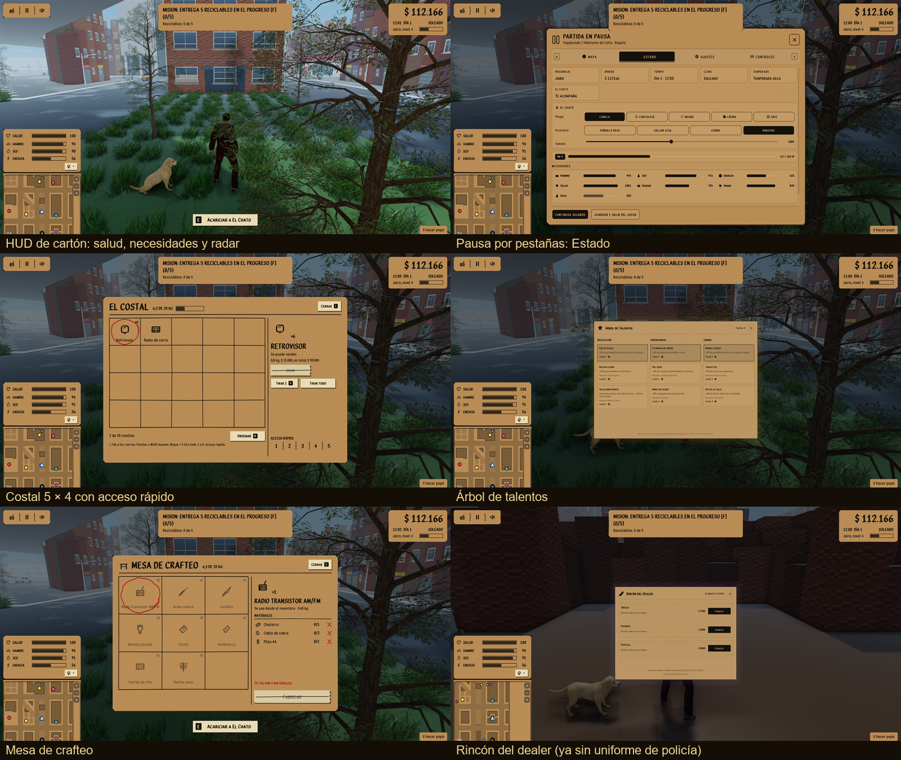
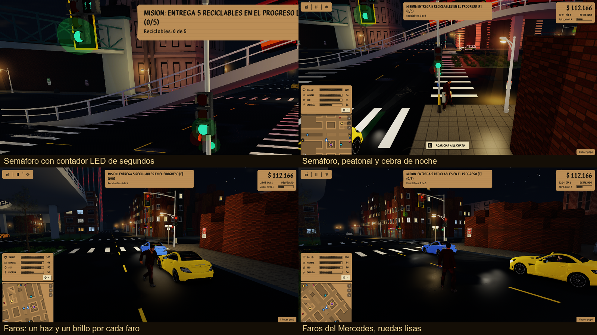
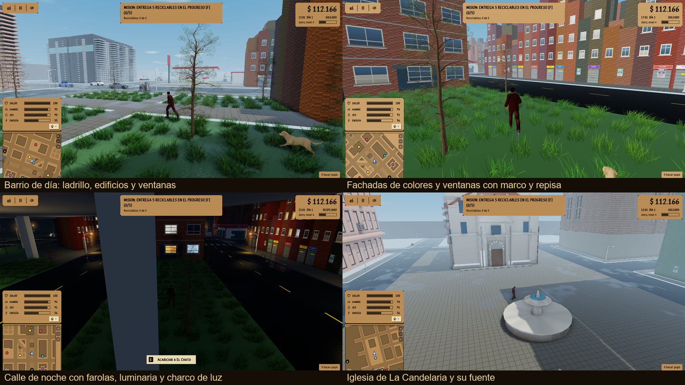
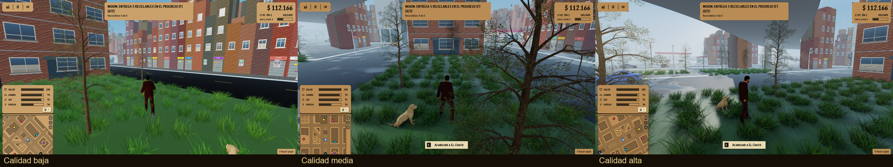

# Port C++/OpenGL: paridad con el juego web, evolución gráfica, interfaz de cartón y ciudad ampliada

Reemplaza al PR #26 e incluye todos sus commits más el trabajo posterior.

## Capturas del juego real






Se tomaron con los ganchos `BAZUKO_*` (ver «Cómo probar»), en Windows con una RTX 3050 Laptop.

## Qué trae

**Paridad con el juego web (los commits del PR #26)**
- Clima, GPS, audio, locomoción y El Chato; lago con nado; policía con persecución y sirenas; vehículos con puertas; mapa y mejoras de interfaz.
- Retiro de los modelos sin permiso de redistribución y créditos de los modelos 3D (`docs/creditos-modelos.md`).

**Gráficos (`cpp/docs/plan-hacia-aa.md`)**
- Buffer HDR con mapeo ACES, SSAO (con desenfoque que respeta los bordes), bloom, rayos de luz del sol, clustered shading con hasta 256 luces y mapas de normales.
- Suelo mojado con charcos que se secan despacio según el clima; reflejos en pantalla (por G-buffer en calidad alta).
- Tres cascadas de sombra, sombras de contacto, niebla por altura y volumétrica, decals y haces de faros.
- Hojas y pasto: mipmaps que conservan color y cobertura, recorte con MSAA, gradiente y viento en el pasto; nitidez al reescalar.
- Mediciones (FPS medios, de día): RTX 3050 157 / 146 / 106 y Radeon integrada 74 / 53 / 33 en calidad baja / media / alta.

**Interfaz y datos del original**
- Tipografía «Dios Le Pague», costal de 5 × 4 con acceso rápido 1 a 5, mesa de crafteo, HUD de cartón (necesidades en filas con la orden «a comer», «a beber»…, frío de La Nevera y retazo de lo más urgente, con fichas en pantallas chicas), pantalla de carga con semitono y BAZUKO que se escribe, y los menús de señal azul pintados con la paleta de cartón. `BAZUKO_UI_OSCURA=1` devuelve la interfaz anterior.
- Objetos, recetas y textos del cambuche del original; cuchillo, botella picada y arma casera que se sacan con «Usar».
- Dos patrullas (hasta tres) que reaparecen con policías uniformados tras morir.

**Ciudad**
- Ampliación oriental del original con la iglesia colonial de La Candelaria y su fuente.
- Fachadas de colores variados (ladrillo, ocre, azul, verde, rosa, lila…) en edificios con modelo y de caja; ventanas con relieve (marco que sobresale, repisa, travesaños, vidrio reflectante y alguna cortina).
- Semáforos del original con lentes redondos y **contadores LED de segundos** (vehicular y peatonales) sincronizados con el ciclo: el amarillo no lleva contador. Los carros paran antes de la cebra.
- Farolas con luminaria brillante, halo redondo que mira a la cámara, cono de luz cálido y charco de luz amarillo en el suelo.
- Faros de los carros con su luz, su haz y su brillo en cada faro (posición medida por modelo); ruedas del Mercedes reparadas.

**Personaje y tráfico**
- Correr nuevo del juego original (clips de Mixamo reorientados al esqueleto con `cpp/tools/agregar_correr_mixamo.py`); el andar cansado lo usan 1 de cada 10 peatones y el jugador sin energía.
- Los carros esperan unos segundos detrás de un vehículo detenido (por ejemplo, una patrulla) y lo rodean por el carril libre sin deslizarse de lado y solo por la calzada; la patrulla se arrima a la orilla en tramo recto y los policías a pie planean su camino evitando vehículos detenidos.
- El dealer usa una apariencia civil.

## Lo que falta o no se verificó
- Del tráfico: el rebase se comprobó en una prueba controlada (un carro detenido y otro que lo rodea); la patrulla llegando a una esquina y el policía a pie rodeando vehículos se corrigieron pero no se vieron funcionar de punta a punta.
- El IK de pies en rampas y las sombras dinámicas lejanas.
- Cambuche funcional del original (llama y frío), el aviso de interacción inferior y el radar siguen con el estilo anterior.
- Las torres altas con textura conservan sus ventanas pintadas en la textura.
- Las pruebas son de lógica (`ctest`, 13 pasan); lo visual se revisó en capturas locales, no en otros equipos.
- Licencias: los audios de policía y los modelos de terceros que siguen en el repositorio tienen licencia por revisar. Los clips de Mixamo se pueden usar en juegos, pero Adobe no permite redistribuirlos sueltos.

## Cómo compilar
Requisitos: compilador de C++20 (Visual Studio 2022 con «Desarrollo para el escritorio con C++» en Windows; GCC o Clang en Linux), CMake 3.22 o posterior, Git y Git LFS (`git lfs pull` descarga los efectos WAV pequeños). El proyecto debe quedar dentro del repositorio (`bazuko/cpp`): busca los modelos y el audio en `../public`. GLFW, GLM, Dear ImGui, libwebp y las bibliotecas de Opus se descargan solas con CMake.

Windows (PowerShell):
```powershell
git lfs pull
cd cpp
cmake -S . -B build
cmake --build build --config Release --parallel
.\build\Release\bazuko.exe
```

Linux o WSL2 (Ubuntu):
```sh
sudo apt install build-essential cmake ninja-build pkg-config libx11-dev libxrandr-dev libxinerama-dev libxcursor-dev libxi-dev libgl1-mesa-dev
git lfs pull
cd cpp
cmake -S . -B build -G Ninja
cmake --build build -j
./build/bazuko
```

Compilación cruzada a Windows desde WSL con MinGW-w64: ver `cpp/README.md`.

## Cómo probar
```sh
ctest --test-dir cpp/build -C Release
```
Capturas y comparaciones con el equipo propio (variables de entorno, todas opcionales):
```sh
BAZUKO_BENCH=1 BAZUKO_QUALITY=2 BAZUKO_NOADAPT=1 BAZUKO_HOUR=22 BAZUKO_POS=56,38 BAZUKO_YAW=5.0 BAZUKO_PITCH=0.3 BAZUKO_DIST=8 BAZUKO_SHOT_DELAY=5 BAZUKO_SHOT=captura.png ./bazuko
```
`BAZUKO_QUALITY` (0 baja, 1 media, 2 alta), `BAZUKO_HOUR`, `BAZUKO_WEATHER`, `BAZUKO_POS=x,z`, `BAZUKO_OPEN_UI=pausa0|crafteo|dealer@s` abren un panel; `BAZUKO_BLOCK_TEST=s` detiene un carro para ver cómo lo rodean los demás.
