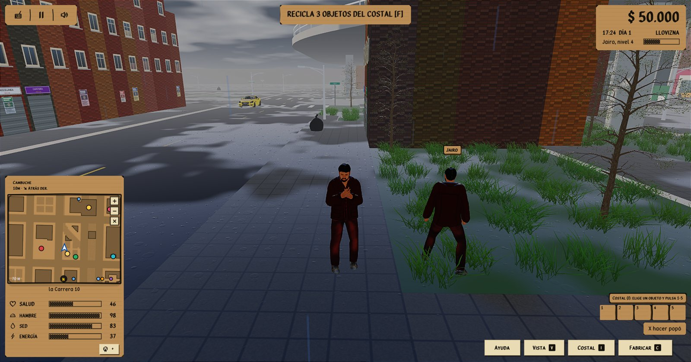

# Jugar por internet (sin abrir puertos)

El multijugador del port en C++ funciona de dos maneras:

| Modo | Para qué | Qué hace falta |
|---|---|---|
| **Directo** | Red local (LAN) o un anfitrión con el puerto UDP abierto en su router | La IP y el puerto del anfitrión |
| **Por relevo** | Internet, cada jugador detrás de su router, sin abrir nada | Un **servidor de relevo** con IP pública (`bazuko_relay`) |

Todo lo demás (mundo compartido, combate, economía, perfiles, migración y traspaso de anfitrión) es igual en los dos modos.
El multijugador se compila por defecto. Con `-DBAZUKO_NET=OFF` se compila el juego de un jugador, sin red.

```sh
cmake -S cpp -B cpp/build
cmake --build cpp/build --config Release
```

## Desde el lobby

Lo normal es usar el lobby al abrir el juego: **Multijugador** muestra la lista de salas abiertas y deja crear una o entrar.

- **Salas de esta red**: un anfitrión directo responde a una pregunta por difusión UDP en el puerto **7779** (`src/net/RoomDirectory.cpp`), así que quienes estén en la misma red lo ven en su lista sin escribir la IP. El juego sigue en el puerto 7777.
- **Salas por internet**: se abren en el servidor de salas (el relevo de abajo). Una sala **pública** aparece en la lista de todos los que usan ese servidor; una **solo con código** no aparece y se entra escribiendo el código. El jugador no escribe ninguna dirección: el lobby dice «Servidor de salas: automático» (ver abajo).
- **Unirse con código o IP**: un código de 6 caracteres entra por el servidor de salas; una IP (con `:puerto` si no es 7777) entra directo.

### Servidor de salas automático

Al abrir el lobby, el juego descarga en segundo plano la **lista de servidores publicada**, [`cpp/servidores.json`](../servidores.json), desde la rama `main` de GitHub, y pregunta por las salas a todos los de la lista. Las salas nuevas se abren en el primero que responda. Para cambiar el túnel o pasar a un VPS basta con editar ese archivo y subirlo: no hace falta publicar otra versión del juego.

```json
{ "version": 1, "servidores": [ { "direccion": "nombre.tun.ply.gg:12345", "nota": "relevo con túnel de playit" } ] }
```

- Si la descarga falla (sin internet, GitHub caído o archivo mal escrito), se usa la **última lista descargada**, que queda en `bazuko_ajustes.json` (`relayCache`). Si nunca se descargó ninguna, se usa el **servidor de respaldo grabado al compilar**.
- Al compilar: `-DBAZUKO_LISTA_SERVIDORES=<url>` cambia la URL de la lista y `-DBAZUKO_SERVIDOR_SALAS=host:puerto` cambia el respaldo. Al ejecutar, las variables de entorno con los mismos nombres mandan sobre ambos. Una ruta local en vez de una URL sirve para pruebas.
- La descarga usa WinHTTP en Windows y `curl` en macOS y Linux. Solo envía un User-Agent genérico (`Bazuko/1.0`), lee como máximo 64 KB y acepta hasta 8 direcciones `host:puerto`.
- **Cambiar** (al pie de Multijugador) permite escribir otro servidor, por ejemplo uno de prueba. **Automático** vuelve a usar la lista.

Para probar la lista sin otro jugador: `bazuko_relay` y luego `bazuko_net_bots --salas-demo [--relevo IP:puerto]`, que abre una sala pública y una solo con código en el relevo y otra en esta red.

## Sin VPS ni IP pública: el relevo en su PC con un túnel de playit.gg

Si nadie tiene una máquina con IP pública, el relevo puede correr en el PC de un jugador y salir a internet por un túnel UDP gratuito de [playit.gg](https://playit.gg)
(sin tarjeta). Funciona aunque el operador use CGNAT. El túnel existe solo mientras ese PC está prendido con el relevo y playit corriendo.

1. Descargue el agente de playit desde sus versiones oficiales en GitHub (`playit-cloud/playit-agent`): `playit-windows-x86_64-signed.exe` corre sin instalar
   ningún servicio. El paquete de winget `DevelopedMethods.playit` trae solo la ventana y pide el servicio aparte («The playit service isn't running»).
2. Ejecútelo; muestra un enlace `https://playit.gg/claim/...`. Ábralo, inicie sesión (o cree la cuenta) y verifique el correo: con el correo sin verificar
   el túnel se apaga y se prende solo.
3. En playit.gg, **Tunnels → Add Tunnel**: tipo **UDP**, **Port Count 1** (es cuántos puertos, no cuál), endpoint público el que venga (Global Anycast),
   **Local IP `127.0.0.1`**, **Local Port `7770`** y **Proxy Protocol None** (con otro, el relevo no entiende los paquetes).
4. En el mismo PC corra `bazuko_relay` (puerto 7770).
5. Ponga la dirección pública del túnel (`nombre.tun.ply.gg:12345`) en `cpp/servidores.json` y súbala a `main`. Todos los jugadores la reciben al abrir el lobby,
   sin escribir nada. Para probar antes de subirla: «Cambiar» en el lobby. Desde ahí funcionan la lista de salas públicas, los códigos, la migración y el traspaso.

### Que el juego levante el servidor solo

En el PC que aloja el servidor de salas, el juego puede levantar el relevo y playit al abrir, sin tener que acordarse de correrlos. En
`bazuko_ajustes.json` (junto al juego):

```json
"servidorPropio": { "activo": true, "playit": "C:/ruta/playit-cli.exe" }
```

- **Al abrir el juego**, antes del lobby, se lanza `bazuko_relay` como proceso aparte y sin ventana (`--mientras-juegue`). El relevo abre playit
  (sin ventana, con su registro en `playit.log` junto a playit) y lo cierra cuando él se cierra, aunque sea por un fallo.
- **Si ya estaba corriendo** (porque otros seguían jugando), la copia nueva encuentra el puerto ocupado y se cierra sin tocar nada: las salas siguen.
- **Al cerrar el juego no se corta a nadie**: el relevo sigue mientras haya una sala en uso, o esperando a su nuevo anfitrión, o un juego abierto en
  este equipo. Cuando lleva un minuto sin nada de eso, se cierra solo y cierra playit.
- Probado: con el juego cerrado y otra persona con salas abiertas por el túnel, el relevo y playit siguieron vivos. Se cerraron solos unos dos minutos
  después de que esas salas se fueron: un minuto que la sala espera a su nuevo anfitrión y otro sin nadie. Al reabrir el juego con el relevo corriendo,
  quedó uno solo.
- El registro del relevo queda en `bazuko_relay.log` junto al juego. Solo funciona en Windows; en otros sistemas hay que correr el relevo a mano.

Probado: con el relevo y `bazuko_net_bots --salas-demo` en un PC y el lobby apuntando a la dirección de playit, la lista mostró la sala pública (no la privada)
y el juego entró a esa sala por el túnel como jugador 2.

Para jugar directo sin relevo también sirve un túnel UDP al puerto **7777** del anfitrión (sala «En esta red»): los demás entran con «Unirse con código o IP»
escribiendo la dirección de playit. Así la sala no sale en la lista y, si el anfitrión se va, la partida no pasa a otro jugador.

## 1. El servidor de relevo

Es un programa pequeño (`bazuko_relay`) que no sabe nada del juego: solo reenvía paquetes entre el anfitrión y sus invitados, por salas con un código de 6 caracteres.
Todos los jugadores se conectan **hacia afuera** hacia él, por eso no hay que abrir puertos en casa. Necesita una máquina con IP pública (un VPS básico alcanza:
cada invitado cuesta unos 6 KB/s) y **un puerto UDP abierto** (por defecto el 7770).

```sh
bazuko_relay            # puerto 7770
bazuko_relay 9000       # otro puerto
```

Limita a 500 salas, 100 invitados por sala y 600 mensajes por segundo por conexión. La lista de salas devuelve hasta 80 salas públicas con anfitrión, con nombres de hasta 32 bytes sin caracteres de control. Una sala sin anfitrión espera 60 s a que alguien la retome (es lo que permite la
migración) y después se borra.

## 2. Anfitrión e invitados por relevo

```sh
bazuko --anfitrion-relay=IP_DEL_RELEVO[:puerto]     # abre una sala y muestra su código (también en el registro)
bazuko --sala=CODIGO@IP_DEL_RELEVO[:puerto]         # entra a la sala de otro jugador
```

También con variables de entorno: `BAZUKO_RELAY=IP[:puerto]` y `BAZUKO_ROOM=CODIGO@IP[:puerto]`.

## 3. Modo directo

```sh
bazuko --anfitrion[=puerto]            # por defecto 7777
bazuko --conectar=IP[:puerto]
```

(`BAZUKO_HOST` y `BAZUKO_JOIN` hacen lo mismo.) Detrás de un router hay que abrir el puerto UDP del anfitrión; para eso es el relevo.

## Qué pasa cuando el anfitrión se va

* **Quién sucede al anfitrión**: cada invitado le cuenta al anfitrión sus cuadros por segundo promedio y la latencia de su conexión (al anfitrión o al relevo).
  El anfitrión ordena a los invitados con esos dos datos: los cuadros por segundo cuentan hasta 60, y cada 100 ms de latencia restan 10 puntos. Quien no llega a 20 cuadros
  o pasa de 300 ms va detrás de los demás, y quien todavía no ha contado nada va al final. A igualdad, va primero el que entró antes. El sucesor solo cambia si otro lo supera
  por más de 8 puntos, para que no salte con cada variación.
  **En esta red** (sin relevo), el sucesor además tiene que poder recibir a los demás. Cada invitado abre en su equipo el puerto de la partida con un
  socket de sondeo, y el anfitrión y los demás invitados le preguntan cada 3 s («BZP?», contesta «BZP!»). A los 10 s de entrar ya se juzga: si no pudo abrir
  el puerto, o el anfitrión o algún otro invitado no le llega, va al final del orden aunque tenga el mejor equipo. Por relevo no hace falta: todos llegan
  al relevo. Esa lista ordenada les llega a todos, y solo el primero recibe la plata, el costal y el nivel de todos
  (cada 1 a 3 s y en cuanto cambia el sucesor).
* **Salir con «Guardar y salir» o cerrando la ventana**: si usted es el anfitrión, el juego pregunta antes de cerrar.
  * Con otros jugadores, dice a quién pasa la partida («La partida pasa a Ana…»). Al confirmar le entrega al sucesor la lista y los perfiles, y los demás se reconectan solos.
  * Con la sala vacía, avisa que la sala se cerrará. La sala sale de la lista enseguida y el servidor de salas la borra al minuto.
* **Cierre forzado, apagón o fallo del juego**: no hay despedida, pero el sucesor ya tiene la lista y los perfiles (se pierde a lo sumo lo de los últimos segundos).
  La caída se nota en 4 a 8 s; antes podía tardar hasta 30. Entonces el sucesor abre la partida (en el mismo puerto, o retomando la misma sala del relevo con su código)
  y los demás se reconectan solos. Si el sucesor tampoco responde en 8 s, entra el siguiente de la lista. En la prueba, con el anfitrión congelado, la partida siguió a los 6,6 s.
* **Un juego trabado no es un juego caído**: si el juego se traba (un cuadro muy largo, la ventana arrastrada), un hilo de red sigue contestando por él hasta
  30 s, así que nadie lo da por caído ni migra la partida. Probado con el anfitrión trabado 12 s. Si sigue trabado más de 30 s, se da por caído.
* **Al conectarse** el plazo sigue siendo de hasta 30 s, por si el otro aún está cargando; el plazo corto (4 a 8 s) empieza cuando ya está conectado.
* **Versiones**: los datos nuevos (rendimiento y sondeo) van al final del mensaje y son opcionales, así que la versión del protocolo sigue siendo la 2 y
  juegan juntas copias anteriores y nuevas. De una copia anterior no se sabe su rendimiento ni si es alcanzable: va después de las que sí lo cuentan.
* **Traspasar sin salir**: **F9** (solo el anfitrión) pasa la partida al siguiente y el antiguo anfitrión vuelve a entrar como invitado.
* Se conservan la hora, el clima, los carros (siguen su circuito desde donde estaban), la gente de la calle, las patrullas que acudían con la sirena y los
  perfiles de todos (plata, costal, experiencia, nivel, talentos). **No** se conservan los policías que iban a pie ni las persecuciones a pie, y las patrullas que acudían
  pasan a acudir al nuevo anfitrión. Las bolsas de basura son de cada jugador (no se comparten), así que no se pierden con el relevo.

## Apariencia

Cada jugador ve a los demás con **su propio personaje** (sexo, edad, pelo, barba, ropa, calzado y colores), no con uno genérico. La apariencia viaja en el saludo y el
anfitrión se la reparte a todos, también a quien entra después. Se lee con validación (nunca se confía: cualquier valor fuera de las opciones del creador se
normaliza). Mientras el personaje de otro jugador se está armando se ve un civil por unos instantes. Si alguien cambia su apariencia en medio de la partida, los demás
la ven al volver a entrar.

## Nombre sobre la cabeza

Cada jugador lleva su nombre en una tirita de cartón sobre la cabeza: el que puso en el creador de personaje, o «Parcero» si lo dejó vacío (máximo 24 caracteres).
El nombre llega en el saludo; el anfitrión lo reparte a todos junto con la apariencia, también el suyo y a quien entra después. Va al final del mensaje de
apariencia, así que una copia vieja del juego sigue jugando con una nueva (solo que la vieja muestra «Jugador N»). Se ve nítido hasta 25 m, se apaga hasta
los 40 m y baja con el jugador cuando está caído.

El nombre solo sale si el jugador está a la vista: si la línea entre las dos cabezas cruza un edificio o un muro (casillas no caminables del mapa), la tirita
se desvanece en una fracción de segundo, para no delatar a quien se esconde. `BAZUKO_LOG_NOMBRES=1` escribe cada segundo si cada nombre está a la vista o tapado.

Los nombres se limpian con `CleanPlayerName` (`net/Protocol.hpp`): quedan letras (también con tilde y la ñ), números, espacios sueltos y `- _ . '`; lo demás
se quita y, si no queda nada, el nombre es «Parcero». Lo aplica el anfitrión al recibir el saludo y cada copia al recibir un nombre, porque nunca se confía en
lo que llega por la red. Si el nombre ya está en la partida (sin importar mayúsculas), el anfitrión le pone un número: «Jairo», «Jairo 2», «Jairo 3». El número
lo ven los demás; cada uno sigue viendo su propio nombre sin número en su pantalla.



## Perfiles

Cada jugador tiene una clave de perfil (`bazuko_clave_perfil.txt`, junto al guardado). El anfitrión guarda su plata, costal, experiencia, nivel y talentos en
`bazuko_perfiles/` (`--perfiles=carpeta`). Un perfil que ese anfitrión no conoce entra recortado (50 000 de plata, 60 objetos, nivel 20): un perfil se gana jugando en
ese anfitrión. **No hay cuentas ni contraseñas todavía**: quien copie la clave es ese jugador.

## Límites actuales

* El relevo no tiene cifrado ni autenticación: cualquiera que conozca su IP puede crear salas (hasta el máximo). Conviene ponerlo detrás de un cortafuegos o
  sobre una VPN si es público. El código de sala (32^6 combinaciones) es lo único que protege una sala, y el secreto para retomarla solo lo recibe el siguiente anfitrión.
* Por relevo cada paquete hace un salto extra: añade la latencia de ir y volver al servidor de relevo (conviene que esté en la misma región que los jugadores).
* Probado en una sola máquina (relevo, anfitrión y dos invitados reales por 127.0.0.1) y con las pruebas automáticas; **no se ha probado con jugadores reales en
  redes distintas ni con NAT de verdad**.
