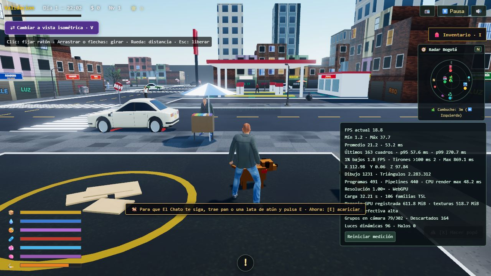
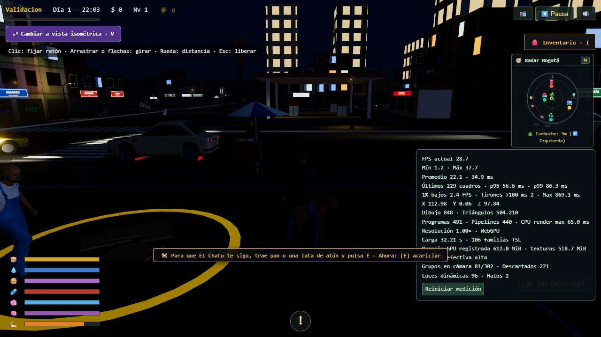
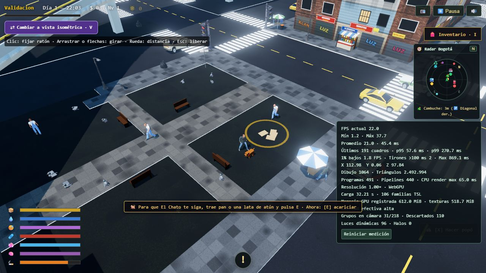
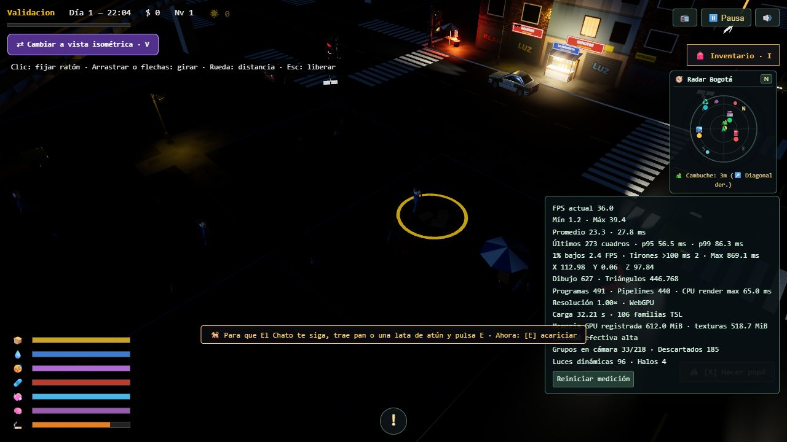

# Actualización de Slop New York

Referencia fijada: `09361be1fe6a2efaee6ef62420a664c677e577b9`. Three.js 0.186.1 y Vite se conservan. Rama de trabajo: `pruebas-slop-actualizacion`; no implica integración ni publicación.

## Inventario inicial

| Sistema | Estado antes de esta entrega | Diferencia comprobada |
|---|---|---|
| WebGPU / TSL / MRT / SSR / bloom | Implementado; pruebas de lógica | Falta matriz visual y medición de GPU |
| Cielo y sombras | Adaptado | Control horario visual separado del reloj |
| Preparación | Adaptación parcial | Calienta tres calidades y dos cámaras antes de jugar |
| Carros agrupados | Adaptación parcial | Solo sedán/taxi habilitados; SUV ya tiene geometría |
| Tráfico IDM y choques | Adaptación parcial | Cruces siguen ligados a semáforos |
| Motores | Pendiente | Grabaciones Howler frente a síntesis del donante |
| Fachadas | Adaptación parcial | Texturas Canvas y microtextura TSL; no equivalen al sistema procedural completo |
| Personajes | Adaptación propia necesaria | Ropa modular, esqueleto y animaciones conservados |
| Cannon / Howler / Lucide | En uso | Ragdoll, voces/radio e interfaz; no son código obsoleto |
| Bicicleta / helicóptero / mapa NY | No aplicable | Fuera del alcance acordado |

## Medición reproducible

Ejecutar producción con `npm run build` y `npm run preview -- --port 5190`. Después `node tools/benchmark.mjs`. Requiere Edge y WebGPU operativo. Tres contextos independientes, una navegación inicial y una recarga por contexto; semilla 44117, 1280×720, DPR 1, calidad alta. La primera navegación incluye creador si no existe guardado; el tiempo interno de carga se registra aparte del tiempo de navegación. Los resultados se guardan fuera del repositorio mediante `BENCH_REPORT`.

La caché GPU del controlador puede persistir entre contextos: «cold» significa caché HTTP del contexto nueva, no purga de caché del controlador. Los intervalos RAF y memoria registrada no son tiempos GPU ni memoria total del proceso. No comparar ejecuciones mientras se compila o se ejecuta la suite en paralelo.

## Implementación entregada

- Preparación inicial: calidad elegida y baja como respaldo, ambas cámaras y objetos fuera de cámara. Media se prepara al solicitarla si aún no está lista. No hay activación automática de configuraciones sin preparar; las tareas de calidad y detalle comparten una cola. Se eliminaron las esperas por cada vinculación y se limitó la concurrencia a ocho familias.
- Fachadas altas: ventanas y juntas procedurales con filtrado integrado de períodos, grafos compartidos y emisivos nocturnos. Se mantienen las texturas y rótulos de pequeños comercios. Se evita calcular otra capa de ruido sobre mapas que ya contienen su detalle.
- Parque automotor: sedán, taxi, SUV, patrulla local y bus urbano en bancos por clase; TransMilenio conserva su servicio independiente. La patrulla es una variante de tráfico, sin incorporar una mecánica nueva de persecución. El selector antiguo/nuevo sigue comparando sedán y taxi; las clases añadidas conservan su representación procedural en ambos modos.
- Tráfico: IDM, seguridad MOBIL, curvas, ruedas, intermitentes y colisiones conectados a entidades existentes. Cinco cruces conservan semáforos y quince usan prioridad con salida libre y PARE en accesos secundarios. Las reservas y la red de Bogotá son adaptadores locales, no una importación íntegra de la simulación de Nueva York.
- Audio: motores por clase, cambios, carga, rodadura, viento del carro ocupado y claxones sintetizados; ocho motores cercanos como máximo y salida al volumen maestro existente. Las grabaciones anteriores no se precargan ni se reproducen junto a la síntesis. Continúan las alarmas y frases locales con sus alcances.
- Velocidad manual: 11,75 m/s normal, 18 con impulso y 5,25 en reversa; curva de aceleración limitada por potencia. El tráfico no recibe esta reducción del 50 %; el bus urbano usa el perfil pesado del donante.
- Recursos: se corrigió el reconocimiento de `EXT_texture_webp` para compartir imágenes de ropa y cuerpos entre modelos y LOD. Se conservan resolución, UV y espacio de color. El mismo reconocimiento contempla AVIF y BasisU.
- Limpieza: retirados la estación GLB sin consumidores, metadatos `.DS_Store`, un entorno neutro reemplazado inmediatamente por la atmósfera y la solicitud inicial de un archivo de animaciones inexistente. Se conservan el respaldo de animaciones realmente usado, Cannon, Howler y los GLB del comparador.

Se consolidaron además doce pares de geometría de calzado idéntica por SHA-256: cada variante rota mantiene su glTF y materiales, pero comparte el `.bin` de la variante normal. Se retiraron 939.284 bytes duplicados; la auditoría de 654 referencias externas glTF no encontró enlaces rotos.

## Mediciones de esta sesión

Edge con WebGPU, producción, 1280×720, DPR 1 y alta bloqueada; semilla 44117. Tres contextos nuevos y una recarga por contexto. La actualización añade tipos de vehículos y cambia la distribución de cruces: no es una comparación que aísle cada modificación gráfica.

| Muestra | Antes (s) | Después de compartir WebP (s) |
|---|---:|---:|
| HTTP nuevo 1 | 33,58 | 28,92 |
| HTTP nuevo 2 | 38,03 | 31,68 |
| HTTP nuevo 3 | 37,75 | 26,48 |
| Recarga 1 | 35,41 | 28,77 |
| Recarga 2 | 40,97 | 36,16 |
| Recarga 3 | 40,36 | 32,11 |

El rango observado pasó de 33,58–40,97 s a 26,48–36,16 s. Las texturas únicas preparadas pasaron de 641/639 a 448/446 (contexto nuevo/recarga), sin reducir su resolución. El problema de WebP impedía etiquetar recursos y el contador de reutilizaciones era cero; después registra más de quinientas referencias compartidas. El tamaño de archivos en disco no explicaba por sí solo el arranque: siguen dominando compilación de grafos/vinculaciones y calentamiento de vistas completas.

En los doce giros medidos no hubo cuadros de más de 500 ms. En la tanda posterior, los máximos fueron 34,2–86,8 ms; p95 27,1–52,8 ms y p99 28,8–77,3 ms. Los intervalos medios posteriores fueron 24,7–40,1 ms. Los percentiles se solapan con los anteriores: **no se afirma una mejora estable de FPS ni una carga de ocho segundos**. El primer giro de un contexto nuevo aún crea un programa y unas 357 vinculaciones; no hay congelación de segundos en estas muestras, pero sigue siendo trabajo por reducir.

Los datos resumidos están en [la comparación reproducible](benchmarks/slop-09361be1.json). Las mediciones se tomaron antes del último ajuste de perfil pesado del bus y la limpieza de la solicitud fallida de animaciones; no se atribuye a esos cambios una mejora medida. El escenario cubre el inicio, giro completo y cambio de cámara, no toda la ciudad ni todos los equipos.

`node tools/asset-inventory.mjs` informa tamaños y duplicados por hash; no autoriza automáticamente a borrar rutas. Los mayores recursos siguen siendo modelos, geometría y catálogo de personajes. `node tools/validate-migration.mjs` revisa WebGPU, clases, apagado diurno, cambios de calidad y genera capturas de día/noche en ambas cámaras. Requiere el mismo servidor de producción y conserva sus resultados en `test-results/migration`.

Validación de cierre: **337 pruebas aprobadas**, compilación de producción correcta, cinco clases presentes, 5 cruces semaforizados y 15 de prioridad. El primer clic medido no creó programas ni vinculaciones y su cuadro máximo fue 40 ms. Los tres cambios de calidad terminaron correctamente; preparar media por primera vez requirió aproximadamente 0,8 s, con controles retenidos durante la preparación. No hubo errores de materiales ni pérdida de dispositivo en esa revisión. La memoria registrada por el renderizador en la comprobación final fue aproximadamente 612 MiB, de ellos 519 MiB de texturas; no equivale a la memoria total del navegador.

Capturas reales de la comprobación, con las imágenes comprimidas como JPEG:

## Límites y continuidad

La migración no equivale a sustituir todo el juego por Slop: permanecen la ropa modular, la lógica de Bogotá, las interacciones y sus adaptadores. Falta una revisión humana de mezcla sonora, comportamiento en recorridos largos y calidad artística de cada fachada. El coste de preparar miles de vinculaciones y de dibujar las paredes que se ocultan individualmente sigue siendo un objetivo de optimización; no se justifica retirarlas sacrificando la cámara isométrica.
