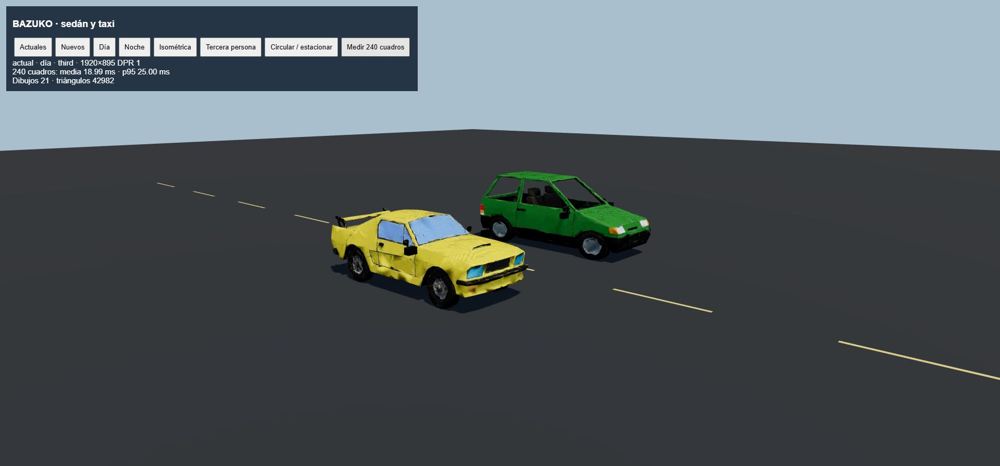
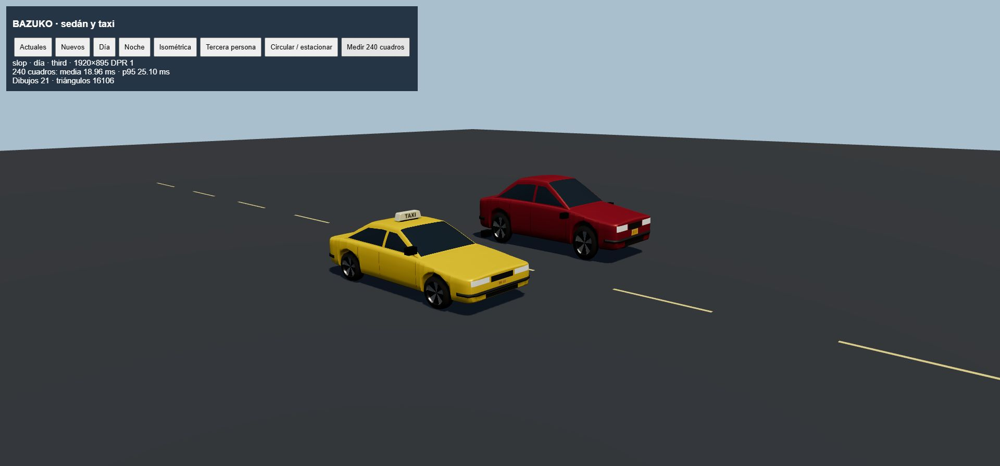
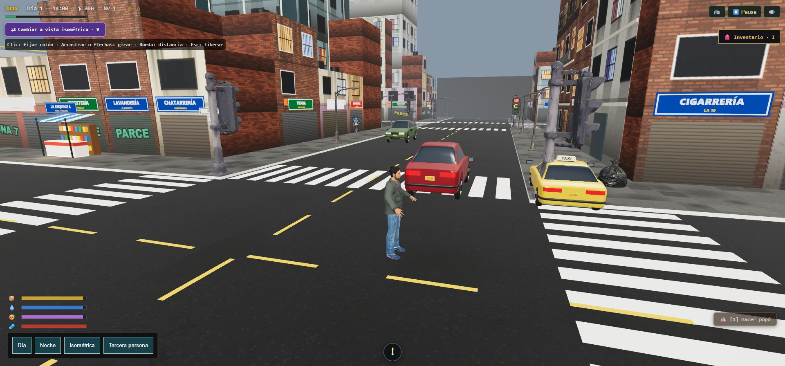
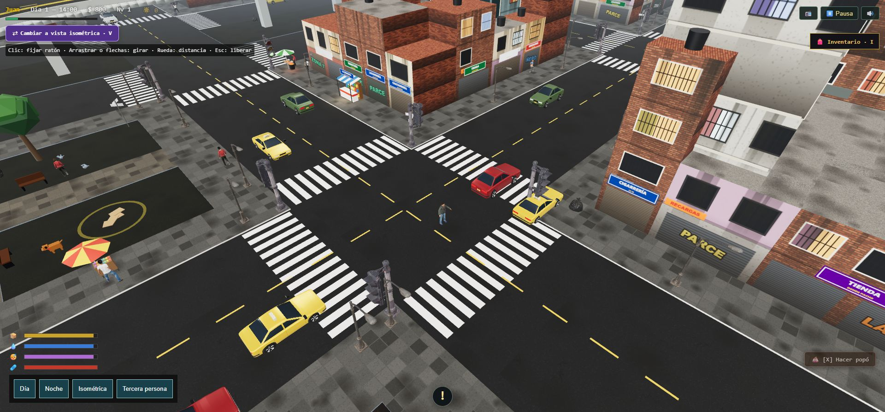
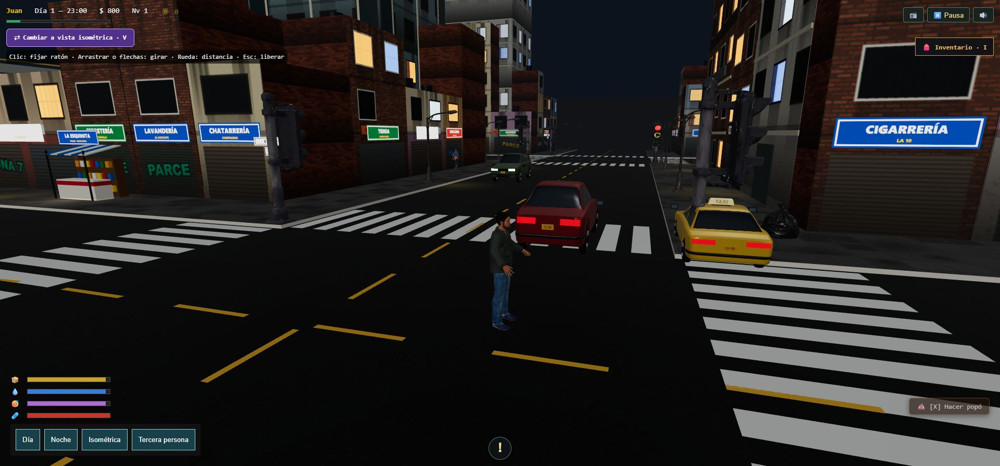
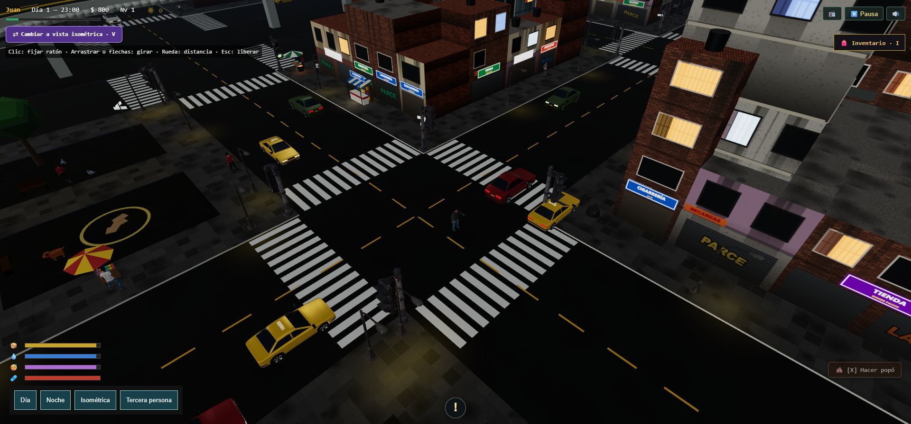

# Vehículos experimentales: primera adaptación de Slop New York

Rama: `pruebas-slop-newyork`, creada desde `main` (`c8ab910`). Esta entrega reemplaza únicamente la representación del sedán y el taxi; Bogotá y TransMilenio conservan sus sistemas actuales. No incluye WebGPU, mapa geográfico ni vehículos instanciados.

## Uso

Los nuevos modelos se seleccionan al iniciar. En **Pausa → Vehículos → Actuales / Nuevos · prueba** se comparan sin reiniciar. Es una preferencia de sesión y no se incorpora al guardado.

`Car.setVisualMode(mode)` es asíncrono. `prepareVisualMode` prepara un candidato antes de sustituir el anterior. El cambio de toda la población espera todas las preparaciones; si alguna falla, descarta los candidatos y conserva las representaciones anteriores. Los tokens de elección impiden que una carga tardía reemplace una elección posterior o resucite un carro eliminado. La pausa bloquea el selector mientras carga y lo recupera aunque se reabra el menú.

Las entidades, posición, giro, rutas, velocidad, semáforos, atropellos, sonidos y enfriamiento siguen siendo los mismos. Los dos retrovisores robables pertenecen a la entidad; la geometría adaptada excluye sus propios retrovisores. El adaptador nuevo mantiene giro de ruedas, frenado y luces nocturnas. Comparte geometría y atlas de rótulos; cada carro libera su material al retirarse, sin destruir el banco compartido.

## Procedencia

Se adaptaron los generadores CPU de `js/actor-models.js` de [Slop New York](https://github.com/mrdoob/slop-newyork/tree/1b54e165ddc26b3e951d5614d56a88995da1da38), revisión `1b54e165ddc26b3e951d5614d56a88995da1da38`. El código incorporado está en `src/vehicles/`; no carga archivos de `work/` ni dependencias del clon externo. Three.js permanece fijado en **0.186.1**. Los materiales son `MeshStandardMaterial` con extensiones GLSL de WebGL para pintura, cristales, llantas, luces y rótulos TAXI/matrícula local. El frente +Z del original se adapta a +X y a las dimensiones existentes de la entidad.

Licencia MIT y aviso completo: [THIRD_PARTY_NOTICES.md](../THIRD_PARTY_NOTICES.md).

## Validación

Resultado: **253 pruebas aprobadas** y compilación de producción correcta.

- Pruebas nuevas: dimensiones y suelo; orientación; recursos compartidos y liberación; ruedas/frenos/noche; cambio conservando robo y reposición; fallo de preparación; elecciones atrasadas; eliminación durante carga; tráfico sin recrear entidades; bloqueo, fallo y reapertura del selector.
- La suite existente cubre colisiones, frenado, atropellos, alarma de estacionados, frases de conductores a 12 m, pausa y volumen. Estas comprobaciones son de lógica; no equivalen a una escucha humana de cada audio.
- Revisión WebGL en navegador: sedán/taxi completos, cristales, rótulos y luces; sin errores de shader en el comparador. Se detectó y corrigió durante la revisión un literal GLSL negativo que generaba un operador `--`.
- Se comprobó el selector en la pausa real: estado deshabilitado durante carga y recuperación al terminar. Capturas urbanas de día/noche en ambas cámaras. El tráfico existente carga las mismas carrocerías y las pruebas ejecutan su movimiento con los adaptadores nuevos.

## Comparación reproducible

Ejecutar `npm run dev` y abrir `/tools/vehicle-comparison.html`. El comparador utiliza las entidades `Car` reales, un sedán y un taxi, posición y cámara fijas, WebGL, sombras, antialias, DPR 1. El botón de circulación anima las ruedas sin desplazar la cámara ni los carros; la circulación en rutas se verifica en el juego y en las pruebas de tráfico.

Para medir: esperar la carga, elegir representación, mantener día/cámara/ventana, pulsar **Medir 240 cuadros**, esperar el resultado y repetir con la otra representación. Los tiempos son intervalos de `requestAnimationFrame`, no tiempos GPU. Dibujos y triángulos proceden de `renderer.info` e incluyen las pasadas del renderizador. No comparar sesiones con distinta población o calidad.

Medición de revisión: 1920 × 895, DPR 1, dos carros estacionados, día, misma cámara y sombras. Resultado de esta sesión:

| Representación | Media de cuadro | p95 | Dibujos | Triángulos |
| --- | ---: | ---: | ---: | ---: |
| Nuevos | 18,96 ms | 25,10 ms | 21 | 16.106 |
| Actuales | 18,99 ms | 25,00 ms | 21 | 42.982 |

Hay menos triángulos en esta escena; no se reducen los dibujos porque todavía no se agrupan vehículos. Los intervalos varían con el navegador y otras cargas. Esta medición aislada **no demuestra una mejora de FPS en la ciudad completa**.

## Capturas

| Actual | Nuevo |
| --- | --- |
|  |  |

| Tercera persona | Isométrica |
| --- | --- |
|  |  |
|  |  |

La integración en `main` y el push quedan para una solicitud posterior. Las siguientes etapas del plan requieren revisar primero esta entrega.
