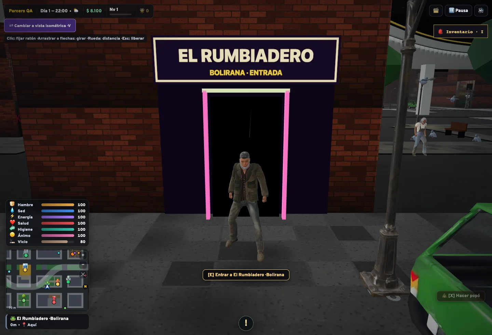
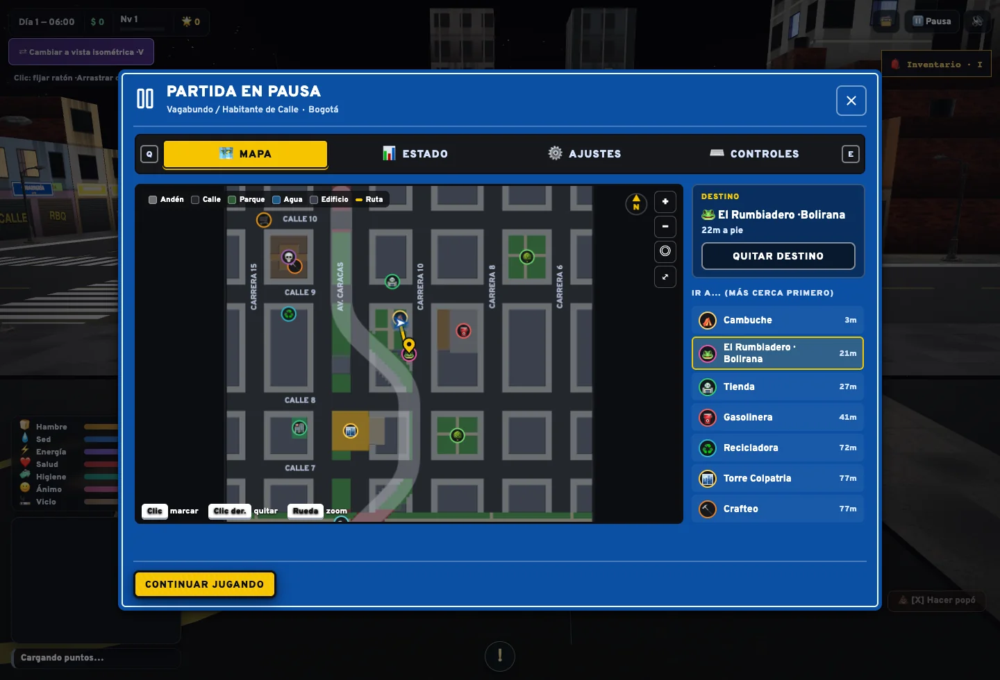
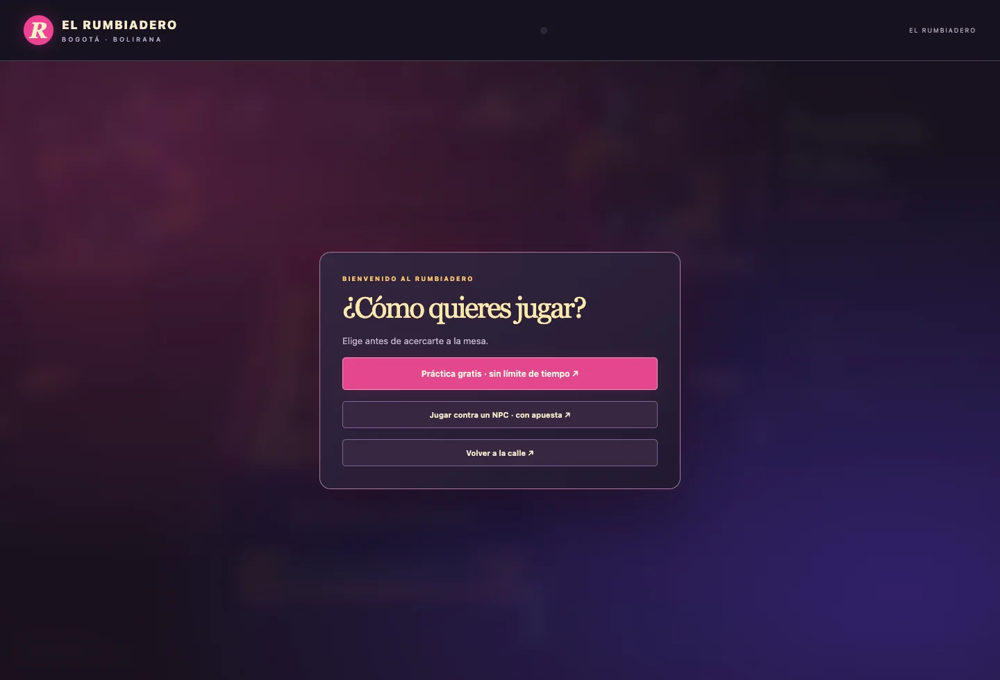
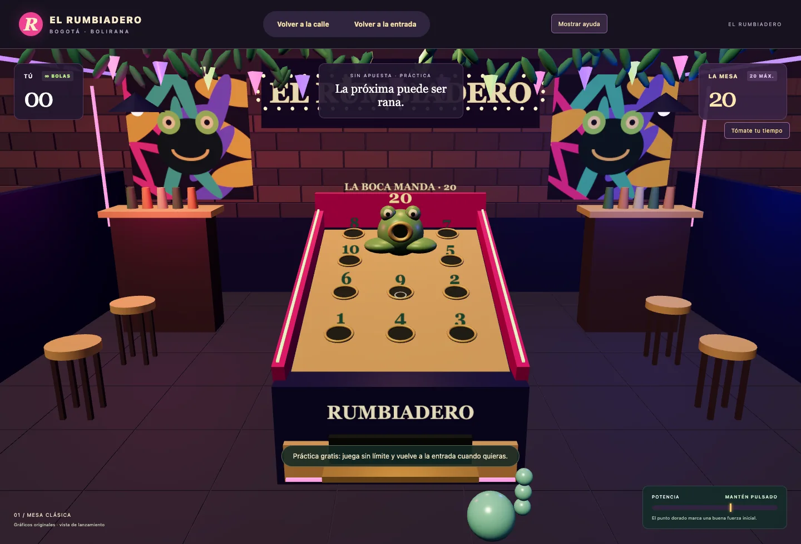

# El Rumbiadero · Bolirana

Aporta una actividad jugable dentro de la ciudad: el personaje entra a un local cerca del cambuche y elige práctica gratuita, partida apostada contra Don Leo o regreso a la calle. La fachada se aplica a un edificio existente; no ocupa la plaza ni cambia el trazado de la ciudad.

## Cómo probarla

```sh
git lfs pull
npm ci
npm run dev
```

1. Crea o carga una partida. Abre el mapa con **M** y selecciona **🐸 El Rumbiadero · Bolirana** para seguir la ruta peatonal.
2. Acércate a la puerta al sur del cambuche y pulsa **E**.
3. Elige **Práctica gratis**, sin límite de bolas, o **Jugar contra NPC** y confirma la apuesta antes de empezar.
4. Apunta con el ratón; mantén pulsado para cargar y suelta para lanzar. La boca de la rana vale 20 puntos; los otros diez huecos tienen valores del 1 al 10 repartidos al azar.
5. Puedes plegar la ayuda de la derecha. **Volver a la calle** regresa a la misma partida y posición.







## Reglas y saldo

- Tres bolas por jugador, primero el personaje y después Don Leo. El límite total es de dos minutos; una partida completada antes se liquida inmediatamente.
- Apuestas del 20 %, 50 %, 100 % o un importe entero personalizado entre $1 y el saldo disponible.
- La apuesta se descuenta y guarda antes de empezar. Ganar devuelve el doble de la apuesta (ganancia neta de una apuesta); perder no genera un segundo descuento. Empatar devuelve lo apostado, sin beneficio.
- Abandonar, cerrar el local o agotar el tiempo antes de completar la partida pierde la apuesta. Recargar conserva el descuento pendiente y reinicia la dificultad: no permite recuperar una apuesta abandonada.
- Cada victoria aumenta la dificultad del siguiente rival; perder la devuelve al nivel 1. El empate conserva el nivel.
- El resultado muestra nombre y puntos de ambos jugadores y, en grande, la ganancia o pérdida neta. Las derrotas incluyen expresiones coloquiales con lenguaje vulgar.

## Integración y límites

`BoliranaSession` administra el saldo desde el juego principal; el interior solicita acciones mediante mensajes con origen, ventana y nonce comprobados. Los puntos, turnos, importe y final se validan; liquidar repetidamente no duplica pagos. Los errores de guardado revierten el cambio en memoria para permitir reintentar.

La simulación de la calle se pausa y el banco de audio urbano se silencia temporalmente, conservando las preferencias del jugador. Al salir se liberan el iframe, los eventos y la música. El local no solicita cámara, micrófono ni ubicación, y no añade servicios externos, dependencias o servidores.

El interior usa una segunda entrada de Vite y la misma dependencia Three.js del proyecto. La física integra gravedad, fricción, rebote en barandas y captura de huecos por barrido: una bola que rueda sobre un hueco puede entrar si cabe en él; una bola elevada no puntúa por pasar por encima.

Este es un minijuego local para un jugador. El iframe contiene código propio y del mismo origen: no constituye una barrera contra código malicioso ni un sistema antitrampas. No añade multijugador, pagos reales, interiores generales para todos los edificios ni implementación de tejo o billar.

## Música y recursos

La música del establecimiento es **SALSA TRAP**, de **Caslo**, del álbum *CASLO Vol. 1*. Consulta su procedencia, licencia y declaración de autorización en [Créditos de audio](bolirana-audio.md). Sus condiciones son independientes de las del código.

Los modelos, carteles y murales del interior se construyen mediante geometría, texto y dibujo originales. Rana Y Bola y los salones bogotanos sirvieron de referencia de juego y ambiente; no se incorporan sus imágenes, modelos ni código.

## Validación

```sh
npm test
npm run build
npx playwright install chromium
npx playwright test tests/e2e/bolirana.spec.js
```

La prueba de navegador usa un contexto desechable, sin partidas personales. Comprueba el marcador y GPS, entrada, práctica, ayuda plegable, regreso a la misma sesión, descuento y guardado de la apuesta, abandono, una partida completa, resultado, actualización del HUD y saldo conservado tras recargar. Bloquea solicitudes externas y exige ausencia de errores de JavaScript.

Para guardar capturas durante esa prueba:

```sh
BOLIRANA_SHOTS=work/bolirana-capturas npx playwright test tests/e2e/bolirana.spec.js
```

Validación de esta entrega: **355 pruebas unitarias aprobadas**, compilación de producción correcta y prueba de navegador completa aprobada en **57 segundos** sobre esa compilación.

Las pruebas unitarias cubren liquidación, empates, plazos, fallos de guardado, ubicación, física de huecos y ciclo de vida de música y silencio urbano. Las comprobaciones automáticas no sustituyen escuchar la mezcla ni valorar el rendimiento visual en cada equipo.
