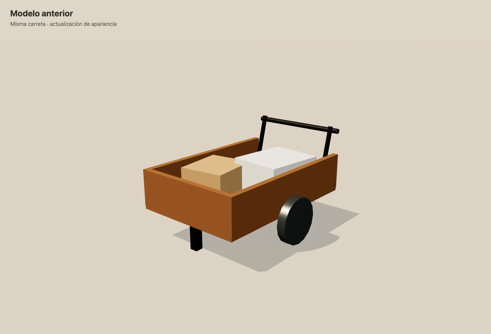
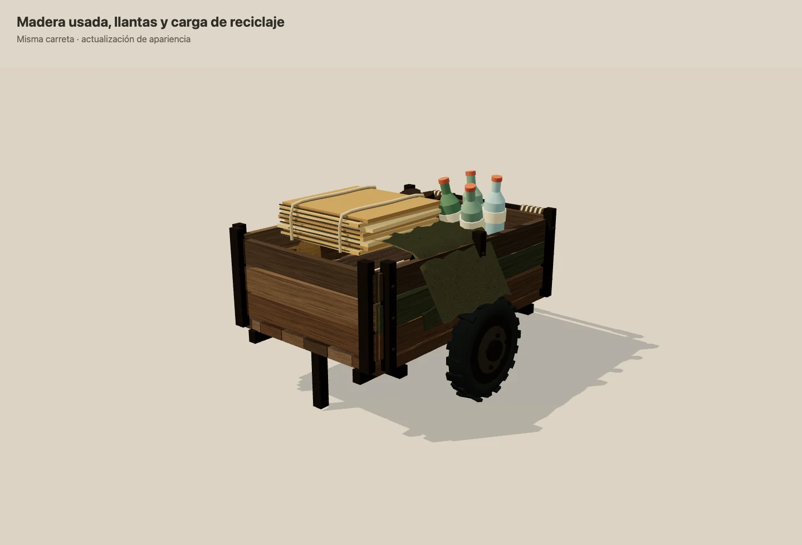
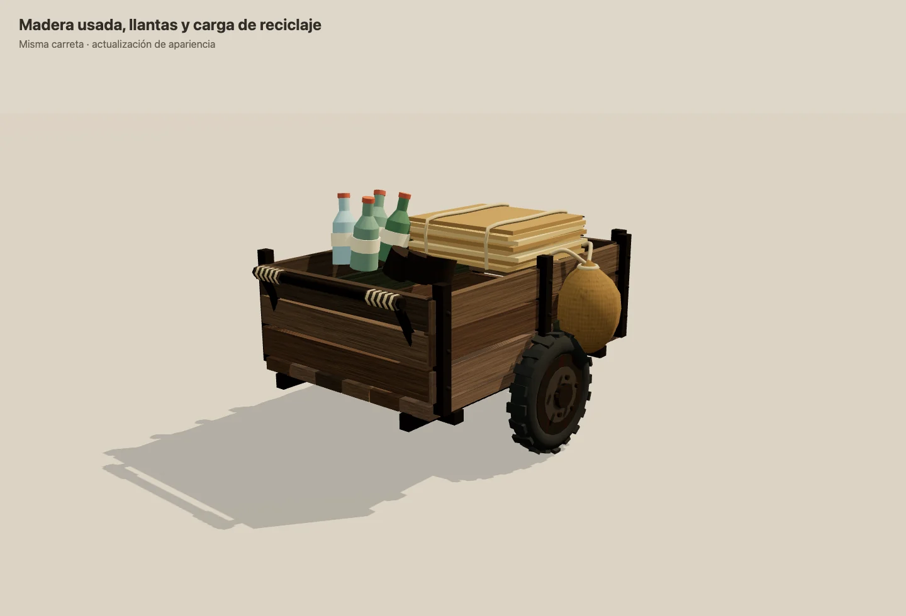
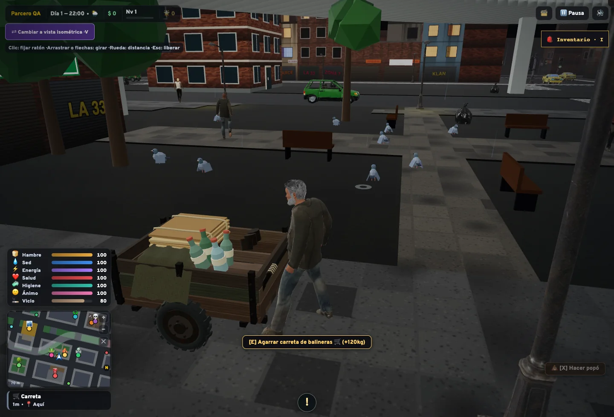

# Apariencia de la carreta de reciclaje

La carreta conserva su manejo y gana una apariencia de construcción artesanal: tablones envejecidos, reparaciones con pintura verde desvaída, chasis y herrajes gastados, llantas de caucho con labrado, rines y tornillos visibles. La carga incluye cartón aplanado y amarrado, botellas, latas, un costal lateral y tela doblada sobre una baranda.

## Antes y después

Capturas reales del modelo del juego en una escena de revisión con la misma cámara e iluminación:





Vista dentro de la partida local, en un contexto de prueba temporal:



La geometría y las texturas son originales y se generan en código. La imagen de referencia aportada por el colaborador sirve como orientación de aspecto y ambiente; no se incorpora como recurso del juego.

## Comportamiento conservado

Las funciones `toggleGrab`, `update`, `saveState` y `loadState` son idénticas a las originales. Se conserva E para agarrar/soltar, el bono de 120 kg, la distancia de 1,4 metros delante del personaje, el rumbo, la animación de las ruedas, el sonido existente y el formato del guardado. El manubrio mantiene la altura y distancia de agarre originales.

Solo se sustituye la construcción del modelo y se adapta su liberación para limpiar los recursos nuevos. No se añaden colisiones, controles, luces ni acciones de inventario a la carga decorativa.

## Recursos y revisión

- Unas 5.500 caras triangulares y 26 mallas visibles, agrupadas por material.
- Tres texturas de 256 × 128 generadas localmente: madera, tela y metal. Los materiales y texturas se comparten entre piezas del modelo.
- Sin descargas, modelos externos ni dependencias nuevas.
- La carga y los costales quedan por debajo de la cabeza del personaje.
- Al eliminar la carreta se liberan geometrías, materiales y texturas compartidos una sola vez.

Comprobaciones realizadas: 328 pruebas unitarias aprobadas en la rama independiente, compilación de producción y revisión desde ambos lados del modelo. La integración local conserva Bolirana y los objetos recuperables, con 371 pruebas unitarias aprobadas. En navegador se verificaron E para acoplar/desacoplar, movimiento, ruedas, capacidad, distancia y guardado en una partida temporal.

```sh
npm test
npm run build
npm run dev
```

En una partida, buscar «Carreta» en el mapa, acercarse y pulsar E. Observar la apariencia al caminar, cambiar de cámara y estacionarla. Las mediciones de geometría y las pruebas automáticas no constituyen una medición de FPS en todos los equipos.
