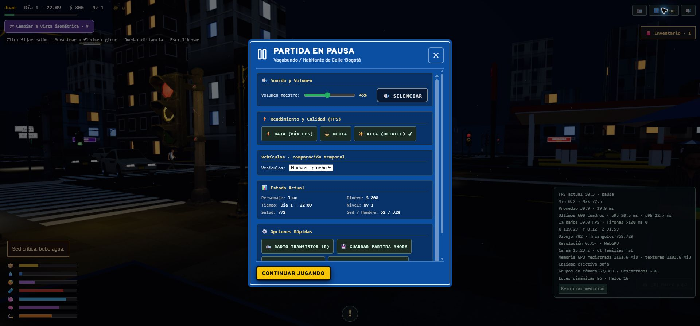
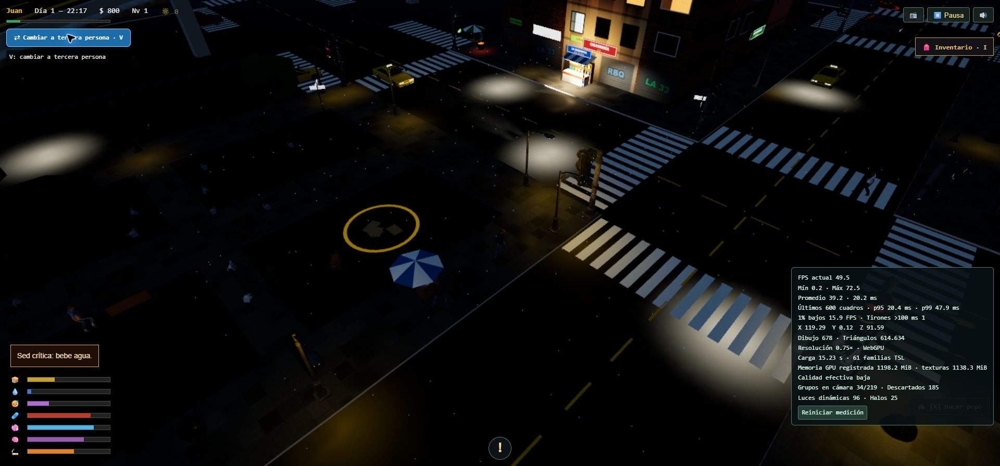

# Migración experimental a WebGPU / TSL

La migración original se integró en `main`. La actualización actual se desarrolla en `pruebas-slop-actualizacion`, sin merge ni push. Solo WebGPU, Three.js 0.186.1 fijado; Vite se conserva. Ver [auditoría, cambios y mediciones actuales](actualizacion-slop.md). Los resultados siguientes describen etapas anteriores, no una garantía de rendimiento de la versión actual.

La base técnica procede de Slop New York, revisión `1b54e165ddc26b3e951d5614d56a88995da1da38`: geometría y materiales de vehículos, organización de cielo/entorno/sol y flujo MRT, SSR, bloom y ajuste de color. Ver [avisos MIT](../THIRD_PARTY_NOTICES.md). Las adaptaciones permanecen en el repositorio; no se carga su CDN `dev` ni se depende del clon en `work/`.

## Perfiles de hora

La atmósfera adopta los cuatro perfiles de iluminación del donante: `golden` (golden hour), `midday`, `blue-hour` y `night`. El reloj de Bogotá los interpola de forma continua —no cambia de escena ni de materiales— y la lluvia suma nubosidad, humedad y reflejos sin perder el inicio nocturno configurado. `Atmosphere.profile` y `Atmosphere.profileLabel` exponen el perfil activo para diagnóstico y futuras interfaces.

## Arquitectura y calidad

El renderizador y el creador se inicializan de forma asíncrona y rechazan el respaldo WebGL. Una pérdida de dispositivo pausa la partida y ofrece recarga; bloquea el guardado mientras la GPU esté perdida.

El cielo y la iluminación siguen el reloj y la humedad existentes. El sol utiliza dos cascadas hasta 140 m; se desactivan de noche y se activan al amanecer. El entorno se actualiza por intervalos, no se regenera cada cuadro. Los faros usan focos sin sombras individuales; las fuentes urbanas utilizan un banco de luces y selección por cercanía.

| Calidad | Sombras | SSR | Bloom | Luces locales activas máximas |
| --- | --- | --- | --- | ---: |
| Baja | No | No | Cuarto de resolución | 16 |
| Media | 2 × 1024 | No | Media resolución | 48 |
| Alta | 2 × 2048 | Media resolución | Media resolución | 96 |

Alta es la preferencia inicial del experimento. Se guarda en `bazuko.webgpu.graphics_quality`, independiente de la versión anterior. Hay un máximo de ocho focos de faros dentro del presupuesto total. La resolución y calidad efectivas pueden reducirse bajo carga sostenida.

Las superficies TSL conservan texturas y rótulos bogotanos. Asfalto y andenes responden a humedad; el lago tiene normales animadas. La opacidad de paredes y los emisivos nocturnos continúan vinculados a sus controles existentes. Las variaciones de casas son deterministas. No cambian el mapa, las colisiones, los edificios emblemáticos ni las rutas.

Las carrocerías se dibujan por instancias, con pintura, frenado, ruedas y noche por instancia. Los retrovisores tienen su propio banco y siguen el estado de robo/reposición. El detalle lejano se reduce a partir de 85 m y las instancias se omiten después de 280 m. El banco admite 256 vehículos por escena y recicla sus entradas sin reasignar buffers por cuadro. Se conserva el selector de modelos actuales/nuevos; ambos usan WebGPU.

## Corrección del bloqueo por memoria

El primer intento agrupaba preparaciones por UUID de material. Las copias de paredes necesarias para ocultación isométrica tenían UUID y grafos TSL distintos, aunque generaban el mismo programa. Se observaron 5.812 trabajos y el navegador terminó con `Out of Memory`.

La corrección comparte grafos por familia y distingue programas por características de material, geometría, instancias y esqueleto. Color, identidad de textura y opacidad no crean familias nuevas; mapas activos, espacios de color, muestreo, transparencia y disposición de atributos sí se distinguen. Se mantienen materiales independientes para las paredes que se atenúan por separado.

La preparación limita la concurrencia a cuatro. Si falla un trabajo, deja de comenzar otros y espera los que ya estaban en vuelo antes de restaurar los destinos de render. La prueba de regresión con 6.000 materiales equivalentes prepara una familia.

También se comparten texturas de recursos externos equivalentes, respetando URL, espacio de color, UV y muestreo. La representación de juego limita imágenes a 1024 px y texturas procedurales Canvas a 512 px. No modifica los archivos originales ni los datos numéricos de texturas especiales. Se conservan colores, transparencia y proporción.

Los peatones siempre preparan su representación ligera. El arranque solo espera los modelos completos a menos de 18 m del jugador; los demás se preparan anticipadamente al acercarse, con textura y shader listos antes de mostrarlos. La transición conserva los umbrales de 7/10 m y las mismas prendas y animaciones.

## Validación y mediciones

Pruebas de lógica: backend obligatorio, reloj/clima, presupuestos, materiales compartidos con opacidad independiente, cambio de vehículos, estados por instancia, descarte asíncrono, retrovisores, agrupación de shaders, texturas y carga de detalle por cercanía. También se conserva la suite de tráfico, colisiones, atropellos, audio, pausa y guardado.

Las mediciones de carga se muestran en el panel de rendimiento, junto a las familias preparadas y la memoria que registra Three.js. Esta memoria no representa toda la memoria del proceso del navegador. El tiempo incluye carga del juego hasta la GPU preparada; no se debe comparar una primera partida que espera al creador con una partida guardada.

Resultados observados durante la corrección, en el mismo navegador:

- Antes de compartir programas: bloqueo a mitad de 5.812 trabajos y fallo de memoria, según las capturas del reporte.
- Con grafos compartidos: 61 familias, carga completa en 24,25 s; se detectó además un gasto de memoria gráfica de aproximadamente 4.520 MiB.
- Con texturas compartidas y límite de resolución: 61 familias, 27,32 s en esa ejecución y aproximadamente 1.911 MiB registrados. Esto redujo memoria, pero por sí solo no mejoró la carga.
- Medicion final con detalle por cercania, cargas independientes en paralelo y subida de texturas sin esperas por cantidad: **15,23 s**, 61 familias, 570 texturas y **1.193 MiB** registrados al terminar. Sin pruebas ejecutandose simultaneamente y sin errores de consola. El reparto fue: recursos 2,57 s, ajuste de texturas 1,04 s, subida 0,63 s, preparacion grafica 3,86 s y primeros cuadros/espera GPU 5,52 s; el resto incluye construccion e inicializacion.
- Otras ejecuciones durante el desarrollo tardaron 33-45 s. La cache, la poblacion aleatoria y la carga del equipo afectan el resultado; 15,23 s es una observacion, no una garantia.

Validacion final: 267 pruebas unitarias aprobadas y compilacion de produccion correcta. Se revisaron la partida nocturna/lluviosa, trafico visible, pausa y cambio entre tercera persona e isometrica. Queda pendiente una matriz completa de recorridos de dia y noche, todas las interacciones manuales y un benchmark repetible de carga fria/caliente. Hay tirones iniciales y reduccion adaptativa de calidad; no se considera terminada la optimizacion de cuadros.

No se garantiza una carga de nueve segundos ni 60 FPS. Slop New York utiliza otra población y recursos; una comparación de rendimiento debe fijar escena, población, cámara, resolución y calidad. Las ejecuciones anteriores mezclan preparación de cachés y no constituyen un benchmark estadístico.

`/tools/graphics-lab.html` ofrece una escena aislada para revisar cielo, materiales, cámaras y efectos. `/tools/vehicle-comparison.html` compara los modelos. Los tiempos de cuadros son intervalos de `requestAnimationFrame`; no son tiempos GPU.
