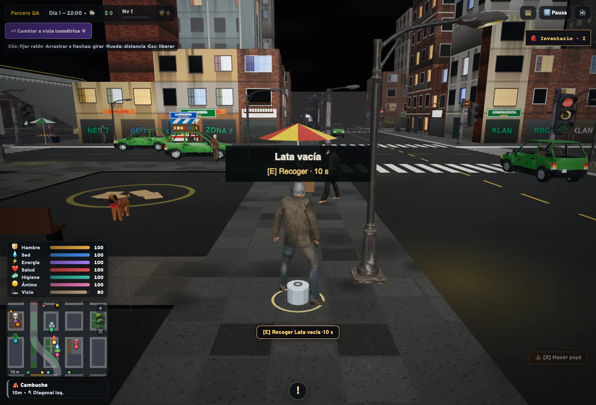
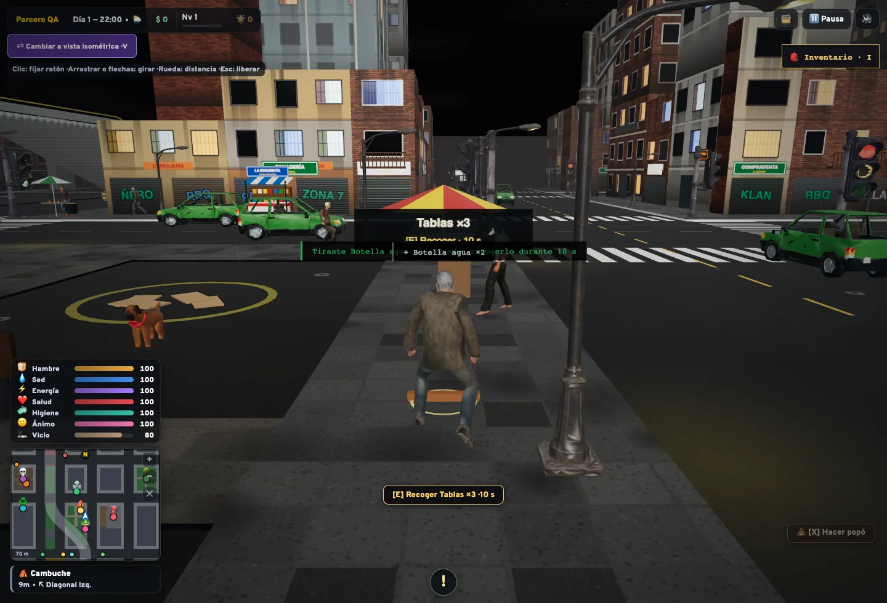
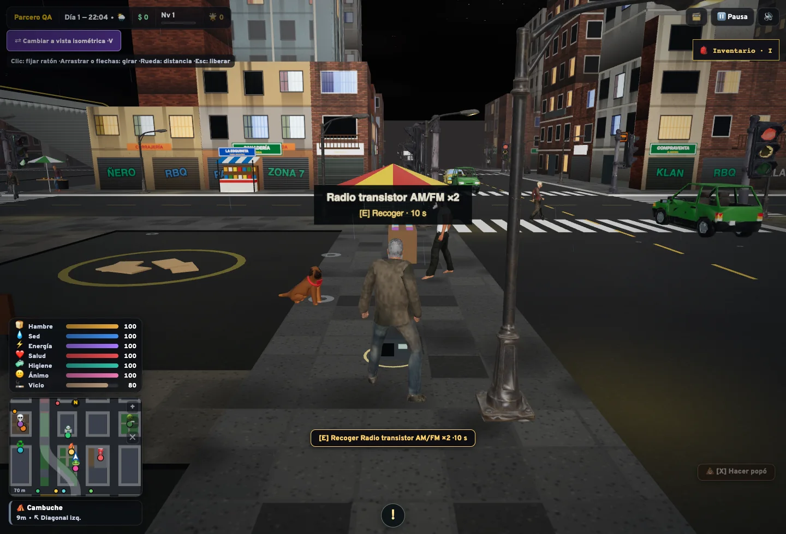

# Objetos soltados del inventario

**Tirar 1** deja una unidad en el suelo. **Tirar todo** deja todas las unidades del tipo seleccionado; no vacía los otros tipos del inventario.

Cada montón tiene un modelo 3D relacionado con el objeto, un anillo y una etiqueta con nombre, cantidad y tiempo restante. Hay siluetas para botellas, latas, comida, radios, pilas, madera, colchón, lona, joyas, herramientas y tratamientos, construidas con geometría original y sin recursos externos.





## Recoger y caducar

Acércate y pulsa **E** para recuperar lo que cabe en el costal. Las unidades que no caben permanecen en el suelo hasta vencer el plazo original. Mantener Q no selecciona ni transforma estos objetos en basura aleatoria.

Los objetos desaparecen después de **10 segundos de juego activo**. Abrir el inventario, pausar o cambiar a una pestaña oculta suspende ese plazo, como el resto de la simulación. Así se dispone de diez segundos al regresar a la calle. Volver a tirar el mismo tipo en un montón próximo añade sus unidades y renueva los diez segundos de ese montón.

Recuperar objetos propios no entrega XP ni nuevas recompensas de rareza y no genera una tirada de enfermedad. No se duplican ni cambian de tipo.

## Colocación, guardado y rendimiento

Se buscan posiciones transitables cerca del personaje, preferentemente delante. Se comprueba la altura de su piso, el recorrido hasta el punto y la ocupación de paredes y vehículos. Los tipos distintos se separan para que sus modelos no se superpongan. Si no hay espacio o ya hay 40 montones, la acción no elimina nada del inventario.

El descarte y la recuperación guardan inmediatamente el inventario. Si falla el guardado, se revierte la operación en memoria. Los objetos de la calle son temporales: no se guardan como objetos permanentes ni reaparecen al recargar. Recargar después de tirar un objeto conserva el descuento del inventario.

Al recoger, caducar o reconstruir el mundo se retiran los objetivos de interacción y se liberan geometrías, materiales y texturas. Una pila grande usa un solo modelo, no un modelo por unidad. No hay luces, descargas, dependencias ni física pesada nuevas.

## Comprobaciones

```sh
npm test
npm run build
npx playwright install chromium
npx playwright test tests/e2e/dropped-items.spec.js
```

La prueba de navegador usa un perfil temporal. Comprueba ambos botones, cantidades, pausa del plazo, recuperación con E, desaparición y guardado tras recargar. No usa ni modifica la partida personal.

Las pruebas unitarias cubren recogida parcial, límite y agrupación de montones, colocación, alturas, vehículos, fallos de guardado, ausencia de recompensas duplicadas y liberación de recursos. Se comprueba también que todos los modelos del catálogo tengan geometría finita apoyada en el suelo.

## Validación de esta entrega

342 pruebas unitarias aprobadas en la rama independiente y compilación de producción correcta. La instalación local, que conserva las mejoras anteriores, aprobó 371 pruebas unitarias y la prueba de navegador completa en 38,7 segundos. Las capturas corresponden a esa prueba local en un contexto temporal.
