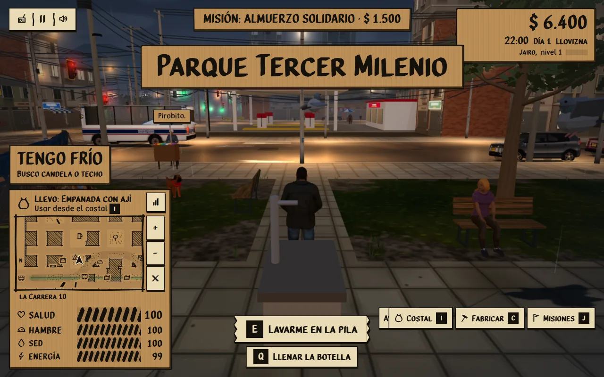
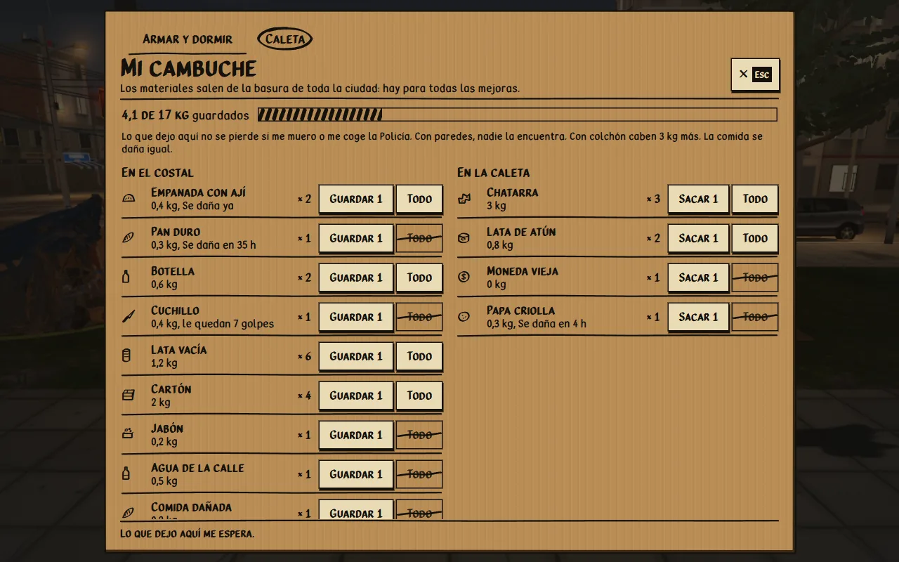
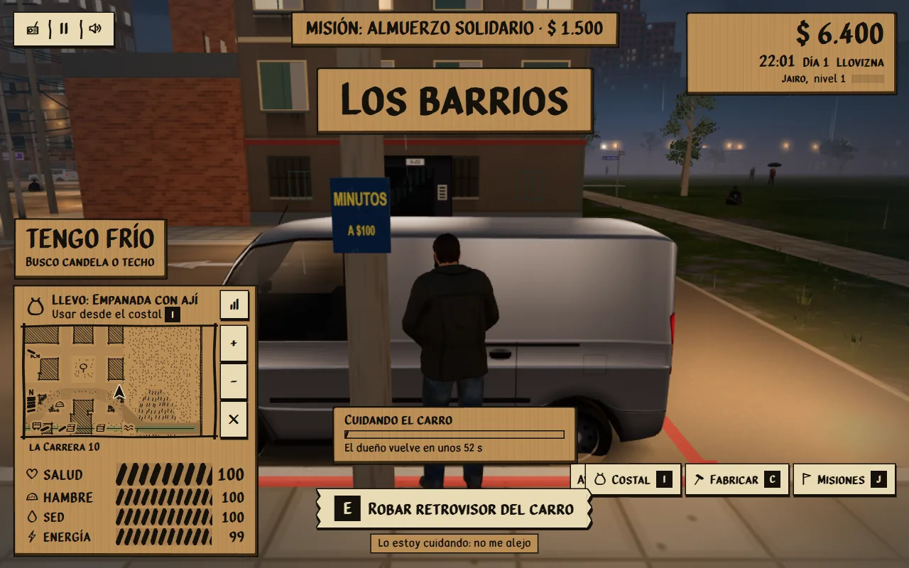
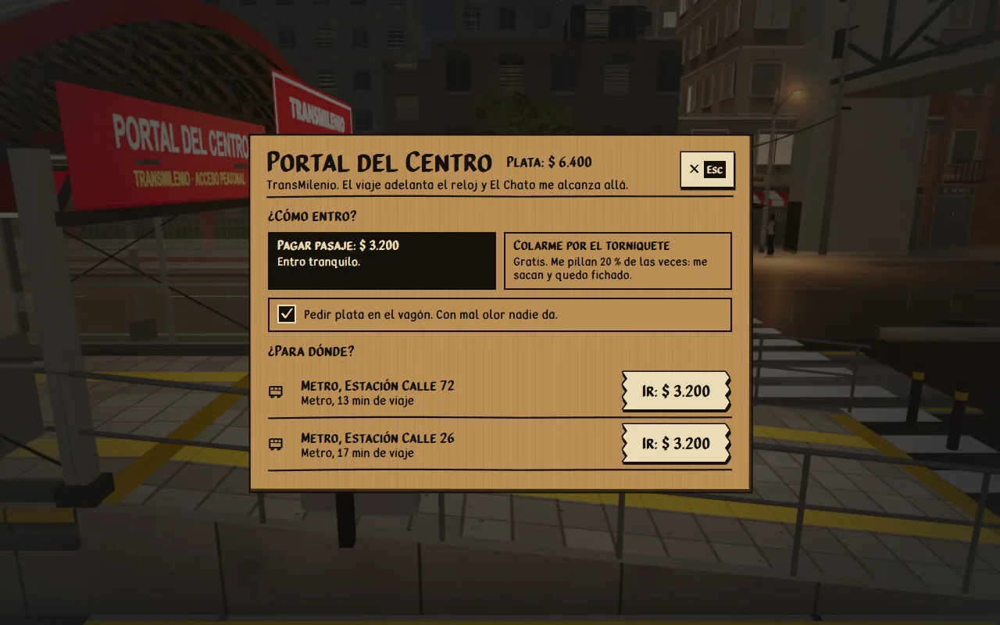
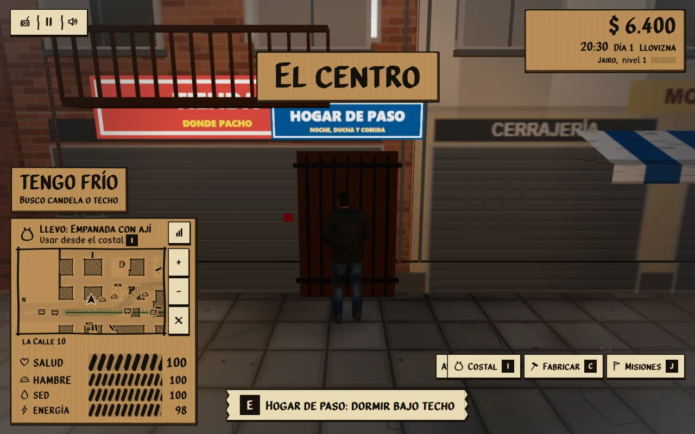
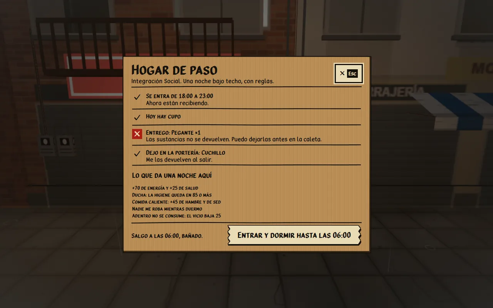
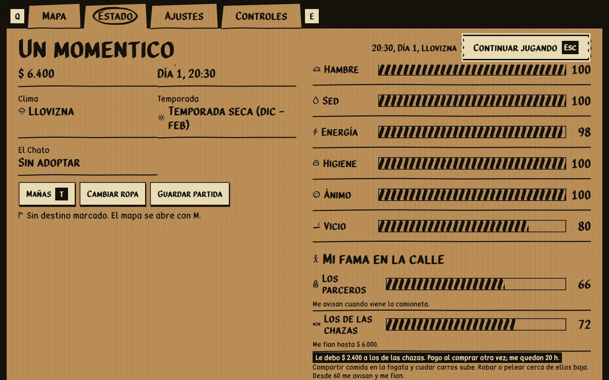
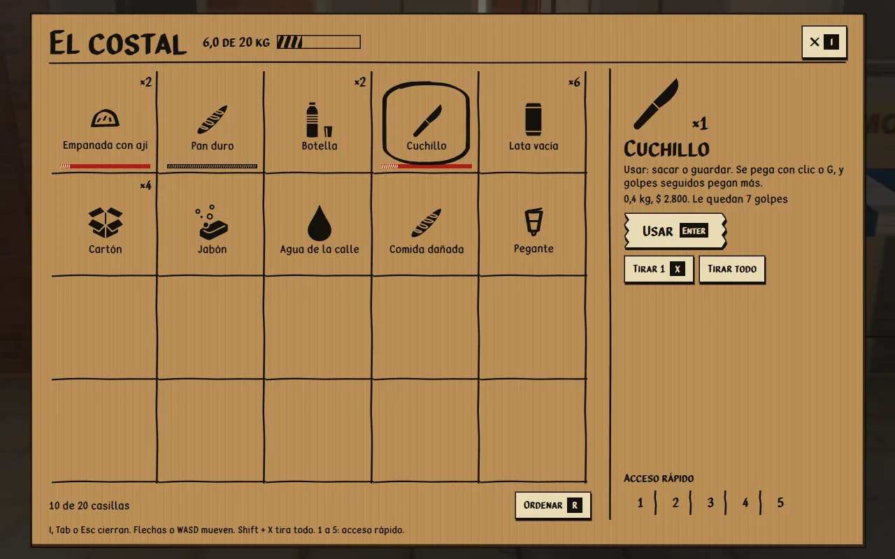

# Vida de calle

Nueve mecánicas que dan razones para volver al cambuche, cuidar la relación con la calle y moverse por la ciudad. Cada una dice en pantalla qué hace antes de hacerlo: la tecla de contexto nombra la acción, las ventanas muestran precio, riesgo y lo que se gana, y el costal enseña lo que se gasta.

| Mecánica | Dónde | Teclas | Módulo |
| --- | --- | --- | --- |
| Caleta | Cambuche, solapa «Caleta» | E en el cambuche | `src/systems/Caleta.js` |
| Fama en la calle | Pausa, pestaña Estado | | `src/systems/Reputation.js` |
| Cuidar carros | Carros parqueados | Q | `src/systems/CarGuarding.js` |
| Comida que se daña | Costal y caleta | | `src/systems/Freshness.js` |
| Armas que se gastan | Costal y barra rápida | | `src/systems/WeaponWear.js` |
| Agua de lluvia | Botella del costal | Usar la botella | `src/systems/StreetLife.js` |
| Pila pública | Tres parques | E lavarse, Q llenar la botella | `src/entities/StreetLifeProps.js` |
| Transporte | Portal del Centro y dos estaciones del Metro | E | `src/systems/Transit.js` |
| Hogar de paso | Un andén a unos 46 m del cambuche | E | `src/systems/Shelter.js` |

`StreetLife` une todo con el juego: escucha los golpes (`street-fight`), los robos a peatones (`pedestrian-robbed`) y los espejos (`mirror-stolen`), avanza con el tiempo de la simulación y se guarda en `street` de la partida. `streetLifePlaces` calcula siempre los mismos sitios sobre el plano de la ciudad, solo en suelo de peatón y sin cajas sólidas encima.

## Capturas

Imágenes reales del juego, tomadas en el navegador con el modelo liviano.

| | |
| --- | --- |
|  |  |
|  |  |
|  |  |
|  |  |

## Caleta

Un hueco escondido en el cambuche. Sin base no hay caleta; cada pieza suma kilos (base 6, techo 3, paredes 8, colchón 3, fogón 2, vela 1). Lo guardado no se pierde al morir ni en un arresto. Sin paredes, cuando roban de noche, una de cada cuatro veces también encuentran la caleta y se llevan la mitad. La comida se sigue dañando adentro y las armas conservan su desgaste.

## Fama en la calle

Dos valores de 0 a 100 que empiezan en 50:

- **Los parceros** (habitantes de calle). Compartir comida en la fogata (Q) sube; robarle o pegarle a un habitante baja. Desde 60, alguien avisa cuando arranca la camioneta de la limpieza social. Desde 80, a veces regalan pan o aguapanela en la candela. Por debajo de 25 no dejan arrimar a la fogata.
- **Los de las chazas** (vendedores ambulantes). Comprarles y cuidar carros sube; robar o pelear a 20 m de un puesto baja, y pegarle a un vendedor baja mucho. Desde 60 fían hasta $ 6.000, que se pagan solos en la siguiente compra; si en 24 horas de juego no se paga, la fama cae. Desde 80 rebajan el 10 %; por debajo de 25 cobran el 20 % más.

Cada cambio de nivel sale como aviso y la pestaña Estado explica qué significa el nivel actual. La Tienda La Esquinita no usa esta fama: es un local, no una chaza.

## Cuidar carros

Junto a un carro parqueado, Q empieza el turno. Un cartón encima de la tecla de contexto muestra el avance y cuánto falta. El dueño vuelve entre 40 y 75 s después y deja entre $ 1.500 y $ 4.500 (a veces nada). Pasados los 9 m avisa; si el jugador sigue lejos 6 s o pasa de 14 m, pierde el turno. Robarle el espejo al carro que se cuida acaba el turno y baja la fama con las chazas. El mismo carro no se puede volver a cuidar en 5 minutos. A los carros en circulación Q les sigue limpiando el parabrisas.

## Comida que se daña

Cada unidad perecible lleva la hora de juego en que se daña (`vence` en la fila del costal): empanada, morcilla y papa criolla 8 h, aguapanela y café 6 h, pan 36 h. Atún, agua y gaseosa no se dañan. Se come y se vende primero lo más viejo. Al vencer, la unidad se vuelve «Comida dañada», que llena poco y la mitad de las veces intoxica, aunque el costal vaya pasado de peso: pesa lo mismo o menos que lo que reemplaza. Una barra en la casilla muestra la frescura, se vuelve roja en el último cuarto y hay un aviso hora y media antes.

## Armas que se gastan

Cada golpe que conecta le quita un uso al arma en la mano: el cuchillo aguanta 40, la botella picada 18 y el arma casera 55. Al quedar un cuarto, avisa; al llegar a cero se parte y, si hay otra igual en el costal, esa sale entera. Los puños no se gastan. La barra de la casilla y la de la barra rápida muestran lo que queda.

## Agua de lluvia y pila pública

La botella vacía de la basura ahora se usa: con lluvia fuerte (intensidad 0,35 o más) o junto a una pila se llena y se vuelve «Agua de la calle» (+30 de sed, 12 % de intoxicación). Las tres pilas están en parques distintos; la primera queda a unos diez metros del cambuche. En la pila, E lava (+35 de higiene, +30 más gastando un jabón, una vez cada 45 s); de noche o con lluvia el agua está helada: quita el calor, cansa y puede dar gripe.

## Transporte

Torniquetes en el Portal del Centro (TransMilenio) y en las estaciones del Metro de la Calle 72 y la Calle 26, en el separador bajo el viaducto. La ventana deja elegir pagar el pasaje ($ 3.200) o colarse: gratis, pero lo pillan el 20 % de las veces, y un 12 % más por cada nivel de fichado; si lo pillan, no viaja, pierde ánimo y sube un nivel de fichado. Se puede pedir plata en el vagón (con mal olor nadie da). El viaje funde a negro, adelanta el reloj según la distancia, deja al jugador al lado del torniquete de llegada y trae a El Chato.

## Hogar de paso

Una puerta con reja y letrero contra una fachada. Se entra de 18:00 a 23:00 y hay cupo tres de cada cuatro noches, siempre el mismo para un mismo día. Las sustancias se entregan y no vuelven; las armas se dejan en la portería y se devuelven al salir, con su desgaste. La noche da +70 de energía, +25 de salud, +45 de hambre y de sed, higiene de 85 o más y ningún robo, pero el vicio baja 25 porque adentro no se consume. La ventana muestra las reglas con lo que pasa en cada una antes de entrar.

## Pruebas

- `tests/street-life.test.js`: la lógica de las nueve mecánicas y la tecla de contexto.
- `tests/street-life-places.test.js`: sobre la ciudad completa, que pilas, hogar y estaciones caigan en suelo de peatón sin cajas encima, se alcancen a pie y salgan siempre en el mismo sitio.

Son pruebas de lógica. Las ventanas, la tecla de contexto y los flujos completos (cuidar hasta el pago, viajar colado, dormir en el hogar, lavarse) se revisaron además en el navegador.
