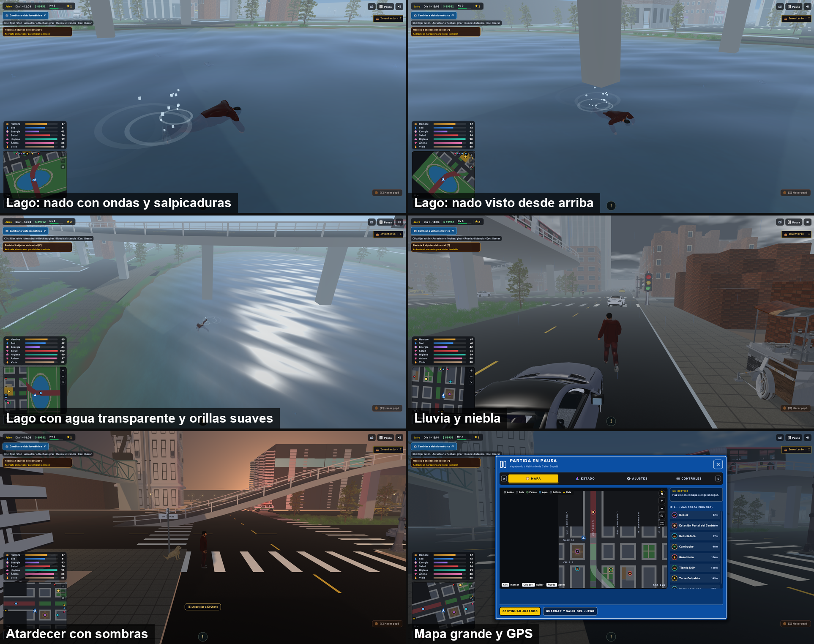
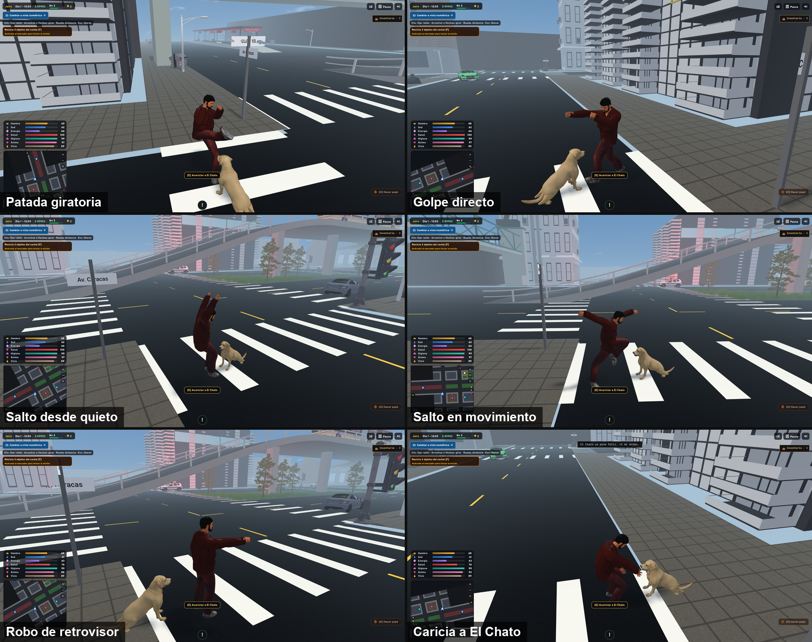
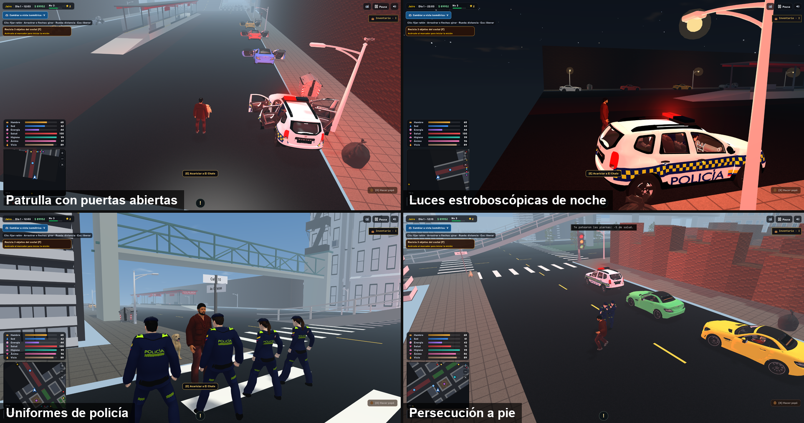

# Port C++ de Bazuko: lago con nado, clima y sombras, combate y saltos por código, policía con persecución y vehículos con puertas

Este PR lleva el port C++/OpenGL (`cpp/`) a paridad con el juego web y más allá: ciudad, tráfico, clima, GPS, radio y El Chato, más un lago real, animaciones de combate y salto armadas con huesos, y una policía que persigue al jugador. Mantiene un rendimiento holgado tanto en tarjeta dedicada como en gráficos integrados.

## Capturas

Tomadas del propio juego (calidad alta, RTX 3050, 1920×1009). Cada una usa un gancho de prueba para fijar la pose o la escena; no son una grabación de partida.

## Rendimiento: tarjeta dedicada frente a gráficos integrados

Equipo: Ryzen 5 7535HS, RTX 3050 Laptop y Radeon integrada, Windows 11, ventana de 1920×1009. Misma escena (calle con tráfico y peatones, 12:00, cielo parcial), resolución fija (sin la bajada automática), 45 s de partida y los 600 últimos cuadros del contador del juego, una corrida por configuración.

| GPU | Calidad | FPS medios | p95 (ms) | p99 (ms) | 1 % bajo (FPS) | Tirones > 100 ms |
|---|---|---|---|---|---|---|
| RTX 3050 | Baja | 187,1 | 6,11 | 6,31 | 154,4 | 0 |
| RTX 3050 | Media | 172,1 | 6,49 | 7,00 | 138,8 | 0 |
| RTX 3050 | Alta | 141,2 | 7,76 | 8,24 | 117,2 | 0 |
| Radeon integrada | Baja | 87,4 | 12,41 | 12,97 | 74,6 | 0 |
| Radeon integrada | Media | 65,8 | 16,36 | 16,95 | 57,8 | 0 |
| Radeon integrada | Alta | 47,1 | 21,93 | 22,32 | 44,0 | 0 |

- Con la tarjeta dedicada las tres calidades superan los 140 FPS medios y el 1 % bajo se mantiene sobre 117.
- Con la Radeon integrada, baja y media superan los 60 FPS; alta (sombras de 2048 px y 1,5× de resolución interna) baja a unos 47, con 44 FPS en el 1 % bajo.
- Las calidades se diferencian en resolución interna (1 / 1 / 1,5×), sombras (ninguna / 1024 px / 2048 px), luces de farolas y detalle del clima y del cielo.
- Para repetirlo: `BAZUKO_BENCH=1 BAZUKO_QUALITY=<0-2> BAZUKO_NOADAPT=1 BAZUKO_HOUR=12 BAZUKO_POS=54,26 BAZUKO_SHOT_DELAY=45 BAZUKO_SHOT=captura.png` imprime el resumen (`BENCH …`) al terminar.
- Medición anterior frente al original web (calidad baja, inicio de partida, antes de MSAA 4x, sombras y lago): 309 FPS medios del port con la RTX 3050 frente a 80 del original, y 134 frente a 71 con la Radeon integrada. No se repitió con las novedades de este PR.

Límites: una corrida por configuración y un solo equipo, así que no es una garantía para otro; la escena es de una calle sin combates ni persecuciones; los valores de calidad alta con gráficos integrados dependen de la carga de la escena.

## Qué cambia dentro del juego

**Lago con agua real y nado.** El Parque del Lago es una elipse de 50 × 26 m con un fondo en cuenco de hasta 2,6 m, orillas suaves (sin dientes de sierra) y agua translúcida con brillo del sol, ondas y salpicaduras. El jugador puede meterse: nada con una brazada de crol por etapas (entrada, jalada con el codo alto, salida), patada alterna y el cuerpo medio sumergido; la ropa no deja ver la piel bajo las axilas. Créditos de los modelos de agua y peces en `docs/creditos-modelos.md`.

**Cielo, clima y sombras.** Cúpula de cielo con gradiente, sol, luna con fases y nubes; siete estados del tiempo con transiciones (sol, parcial, nublado, niebla, llovizna, aguacero, tormenta con relámpagos) y lluvia animada en el vertex shader. Sombras del sol y de la luna alrededor del jugador, solo con lo que se ve (baja no las dibuja, media 1024 px y alta 2048 px), y conversión de color sRGB a lineal para una luz coherente.

**Combate y saltos por código.** Puños, patadas, ganchos, patada giratoria y esquives se arman girando huesos sobre la guardia, con los puños totalmente cerrados; los NPC usan las mismas técnicas. El salto desde quieto (anticipación, impulso con brazos arriba, amortiguación) y el salto en movimiento tienen su propia animación.

**Acciones con las manos.** El robo de un retrovisor mueve el brazo derecho como quien agarra algo rápido y vuelve a la postura normal; revisar basura agacha al personaje y mueve los brazos sobre el objeto todo el tiempo de la revisión; acariciar a El Chato apoya la mano sobre su cuerpo. Los retrovisores se colocan según la carrocería de cada modelo.

**El Chato.** Labrador con animaciones propias (caminar, trotar, correr, sentarse, olfatear, jugar), más grande y con la caricia animada.

**Policía con persecución.** La patrulla es un Renault Duster (CC BY 4.0) pintado como las de la Policía, con baliza estroboscópica roja y azul con resplandor. Conductor y compañero van uniformados (camisa y pantalón completos, botas negras, gorra, letras y franjas en el pecho y la espalda). Si el jugador roba un retrovisor, hace el cosquilleo, roba directo o golpea a alguien, un transeúnte grita «¡Llamen a la policía!» y la patrulla cercana responde al instante: los dos policías bajan por sus puertas, persiguen al jugador, esquivan y devuelven los golpes y rodean los obstáculos. Si el jugador huye y no lo alcanzan, vuelven al vehículo y se van; un delito nuevo mientras bajan, vuelven o suben los reactiva, en ciclo.

**Puertas de todos los ocupantes.** El Mercedes y la patrulla tienen las puertas del conductor, del acompañante y (la patrulla) las traseras como piezas aparte que giran sobre su bisagra. El compañero camina hasta su puerta y sube con la animación espejada, y el conductor lo espera.

**Peatones y vehículos.** Los peatones y los policías ya no se atraviesan entre sí. Un vehículo abandonado solo se retira y reaparece a más de 150 m del jugador, fuera de la vista, y la patrulla vuelve con su compañero.

**Paridad con el juego web.** Radar con GPS a pie, mapa grande y pausa por pestañas, radio con pilas, tráfico por todo el mapa, ambulancia, patrulla, moto de policía y carros con ruedas independientes, calidad gráfica adaptativa, MSAA 4x y filtrado anisotrópico.

## Pruebas

- `bazuko_traffic_test` y `bazuko_spawn_city_test` pasan con los cambios de policías, puertas y colisión entre peatones.
- Lo visual (lago, nado, animaciones, uniformes, puertas, luces) se revisó en el juego con capturas; no hay prueba automática de calidad visual, y un benchmark o una captura no sustituyen probarlo en otro equipo.
- La persecución se revisó con el registro del juego y jugando: bajan, persiguen, regresan y se reactivan con un delito nuevo. No hay prueba automatizada del ciclo.

## Pendiente y límites conocidos
- Las puertas traseras ya se pueden animar, pero ningún ocupante trasero las usa todavía.
- El modelo de la Renault 6 y la Raptor conservan puertas de piezas aparte solo en local: no se suben porque no tienen permiso de redistribución.
- Los modelos de Raptor, Renault 6, Model X, el pitbull y el Transmilenio articulado no se cargan por defecto.
- El renderer usa solo la textura de color de los modelos (no la normal ni la ORM), y las patas de El Chato resbalan algo a velocidad real.
- El cielo de calidad baja conserva solo la hora (sin clima).
